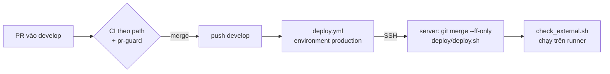

# DOC-15 — CI/CD với GitHub Actions

Trạng thái ngày 14/10/2026. Tài liệu này mô tả các workflow trong `.github/workflows/` và cách chuyển phần deploy tự động sang AWS. Cách dựng server nằm ở [`deploy/README.md`](../deploy/README.md).

## Tóm tắt

- **CI:** mỗi PR chạy kiểm tra theo phần code bị sửa (backend, ai-service, frontend) cộng `pr-guard`.
- **CD:** mỗi lần push vào `develop` (tức là merge PR), workflow `deploy` SSH vào server, cập nhật code, chạy `deploy/deploy.sh`, rồi kiểm tra server từ bên ngoài.
- **Server đích hiện tại vẫn là server cũ** `150.95.104.132` (`contract-intelligence.tech`). Cặp server AWS ở Sydney đã dựng và chạy thử được, nhưng chưa chuyển dữ liệu và chưa nhận deploy tự động (xem "Chuyển CD sang AWS").



## Các workflow

| File | Chạy khi | Làm gì |
|---|---|---|
| `backend-ci.yml` | PR vào `main`/`develop` sửa `backend/**`; push vào `main` hoặc `feature/**` sửa `backend/**` | import-linter, Ruff, MyPy, unit test, integration test trên PostgreSQL thật (`pgvector/pgvector:pg16`, bỏ marker `ai2_local_e2e`) |
| `ai-service.yml` | PR sửa `ai-service/**`; push vào `develop`/`main` sửa `ai-service/**` | Kiểm tra AI1/AI2 |
| `frontend.yml` | PR sửa `frontend/**`; push vào `develop`/`main` sửa `frontend/**` | Kiểm tra frontend |
| `pr-guard.yml` | Mọi PR | Tên nhánh, tiêu đề PR (`<type>(<scope>): …`), nguồn PR vào `main`, cấm commit PDF/ảnh/file nén ngoài `docs/assets/` |
| `labeler.yml` | Mọi PR (`pull_request_target`) | Gắn nhãn theo thư mục |
| `deploy.yml` | Push vào `develop`; bấm tay (Run workflow) | Deploy lên server, rồi kiểm tra từ bên ngoài |
| `deploy-external-check.yml` | Chỉ bấm tay | Kiểm tra từ bên ngoài một server bất kỳ: HTTPS, issuer OIDC, `/admin` bị chặn, `/grafana` 401, các cổng nội bộ đóng |

`pr-guard.yml` tự ghi là "required check", nhưng **`develop` chưa có branch protection** (API trả 404 ngày 14/10), nên một PR đỏ vẫn merge được. Muốn bắt buộc thì admin repo bật protection cho `develop` và chọn các check `pr-guard`, `Backend CI`… làm required.

## Workflow `deploy`

### Các bước

1. **Có server chưa?** Không có secret `DEPLOY_HOST` thì job báo "not configured" và kết thúc thành công.
2. **Khoá SSH:** ghi `DEPLOY_SSH_KEY` và `DEPLOY_KNOWN_HOSTS` ra `~/.ssh` của runner, `StrictHostKeyChecking yes`: runner chỉ nói chuyện với đúng server đã ghim khoá.
3. **Cập nhật và deploy:** trên server, trong `/opt/contract-intelligence`:
   ```bash
   git fetch origin "$BRANCH"; git checkout "$BRANCH"
   git merge --ff-only "$SHA"     # checkout trên server có commit riêng thì dừng, không ghi đè
   deploy/deploy.sh
   ```
   `deploy.sh` build image, kiểm tra DB server (nếu DB ở máy riêng) và nhà cung cấp LLM/embedding của AI2 **trước** khi `up -d`. Kiểm tra lỗi thì stack đang chạy giữ nguyên. Sau đó nó chờ backend và AI2 sẵn sàng, cấu hình Keycloak và chạy smoke test.
4. **Kiểm tra từ bên ngoài:** đọc `API_HOST`, `AUTH_HOST`, `APP_HOST` từ `deploy/.env.prod` trên server, rồi chạy `deploy/check_external.sh` **trên runner**, tức là từ Internet. Có secret `DEPLOY_DB_PUBLIC_IP` thì kiểm thêm cổng 5432/5433 của DB server.

Một lần chạy tối đa 60 phút. `concurrency: deploy-server` bảo đảm hai lần deploy không chạy chồng: lần sau chờ lần trước xong.

### Secrets

| Secret | Giá trị | Có chưa (14/10) |
|---|---|---|
| `DEPLOY_HOST` | IP hoặc tên server | Có, trỏ server cũ |
| `DEPLOY_USER` | User SSH: `root`, hoặc user có `sudo` không hỏi mật khẩu | Có |
| `DEPLOY_SSH_KEY` | Khoá bí mật riêng cho GitHub Actions | Có |
| `DEPLOY_KNOWN_HOSTS` | Dòng `ssh-keyscan -t ed25519 <host>`, đã so tay với khoá của server | Có |
| `DEPLOY_DB_PUBLIC_IP` | IP công khai của DB server riêng (không bắt buộc) | Chưa |

Đặt bằng `gh secret set <TÊN>` (gõ giá trị khi được hỏi), hoặc Settings → Secrets and variables → Actions.

### Duyệt trước khi deploy

Job chạy trong environment `production`. **Hiện environment này chưa có luật nào** (`protection_rules` rỗng ngày 14/10), nên mọi push vào `develop` deploy ngay. Admin repo bật người duyệt theo mục "Duyệt trước khi deploy" trong `deploy/README.md`. Khi đã bật, mỗi lần merge tạo một lần chạy "Waiting"; server chỉ đổi sau khi người duyệt bấm **Review deployments → Approve**.

### Chạy tay

GitHub → Actions → `deploy` → Run workflow, chọn nhánh. Workflow deploy **đúng nhánh được chọn**, nên chỉ nên chọn `develop`. Một nhánh khác sẽ đổi checkout trên server sang nhánh đó, và lần deploy `develop` tiếp theo có thể bị chặn vì không fast-forward được.

## Chuyển CD sang AWS

Việc cần làm theo thứ tự. **Chưa làm bước nào** (14/10).

### 1. Cho runner SSH được vào app server

Security group `ci-app` chỉ mở cổng 22 cho IP của người vận hành. Runner GitHub chạy từ dải IP rất rộng và thay đổi, nên hiện **không SSH vào được**. Có ba cách:

| Cách | Làm gì | Ưu | Nhược |
|---|---|---|---|
| **A. Mở cổng 22 tạm thời cho mỗi lần chạy** (đề xuất) | Workflow đăng nhập AWS bằng OIDC (không lưu access key), thêm IP của runner vào `ci-app`, deploy, rồi xoá rule ở bước `always()` | Cổng 22 chỉ mở vài phút cho đúng một IP | Phải tạo IAM role tin GitHub OIDC. Tài khoản nằm trong Organization có policy riêng; chưa thử tạo role |
| B. Mở cổng 22 cho mọi IP | Thêm `0.0.0.0/0` vào cổng 22 của `ci-app` | Không cần sửa workflow | Ai cũng gõ cửa SSH được (vẫn chỉ đăng nhập bằng khoá). Nên kèm `fail2ban` |
| C. Self-hosted runner trên app server | Cài GitHub runner trên `ci-app`, chỉ job `deploy` dùng | Không mở cổng nào | Runner chạy code của repo ngay trên server prod; phải giới hạn chặt workflow nào được dùng nó |

Với cách A, workflow cần `permissions: id-token: write`, bước `aws-actions/configure-aws-credentials` với `role-to-assume`, rồi `aws ec2 authorize-security-group-ingress` và `revoke-security-group-ingress` trên `sg-070e3d258f1793c3e`. Role chỉ cần quyền hai thao tác đó trên đúng security group này.

### 2. Khoá SSH riêng cho GitHub Actions

Không dùng `ci-deploy-aws.pem` của người vận hành:

```bash
ssh-keygen -t ed25519 -N "" -C github-actions-deploy -f ./deploy_key
ssh -i ~/.ssh/ci-deploy-aws.pem ubuntu@52.63.103.239 'cat >> ~/.ssh/authorized_keys' < ./deploy_key.pub
ssh-keyscan -t ed25519 52.63.103.239   # so với khoá đã thấy khi SSH lần đầu
```

User `ubuntu` trên EC2 có `sudo` không hỏi mật khẩu, đúng như workflow cần.

### 3. Checkout trên app server theo `develop`

App server đang chạy nhánh `feature/code-full`, vì `compose.db.yml` và bản sửa Caddy chưa có trên `develop`. Sau khi PR #77 merge:

```bash
ssh -i ~/.ssh/ci-deploy-aws.pem ubuntu@52.63.103.239 \
  'cd /opt/contract-intelligence && sudo git fetch origin develop && sudo git checkout develop && sudo git merge --ff-only origin/develop'
```

### 4. Đổi secrets, sau khi đã chuyển dữ liệu

Đổi secrets **sau** bước chuyển dữ liệu và DNS ("Chuyển sang máy mới cùng dữ liệu" trong `deploy/README.md`). Đổi sớm hơn thì các lần merge sẽ deploy vào server thử, còn prod vẫn ở server cũ.

| Secret | Giá trị mới |
|---|---|
| `DEPLOY_HOST` | `52.63.103.239` (Elastic IP, không đổi khi stop/start) |
| `DEPLOY_USER` | `ubuntu` |
| `DEPLOY_SSH_KEY` | Nội dung `deploy_key` ở bước 2; xoá file sau khi đặt |
| `DEPLOY_KNOWN_HOSTS` | Dòng `ssh-keyscan` ở bước 2 |
| `DEPLOY_DB_PUBLIC_IP` | Bỏ trống, hoặc gắn Elastic IP cho DB server rồi điền (thêm khoảng $3,6/tháng) |

DB server chỉ có IP công khai tự cấp, nên **IP này đổi mỗi lần stop/start**. Điền `DEPLOY_DB_PUBLIC_IP` mà không gắn Elastic IP thì sau lần start tiếp theo, bước kiểm tra sẽ kiểm nhầm một IP không còn là của mình.

### 5. Chạy thử một lần

Actions → `deploy` → Run workflow trên `develop`, xem đủ ba bước xanh, rồi mới bật người duyệt cho `production`.

## Khi server đang stop

Hai máy AWS được stop ngoài giờ demo để tiết kiệm credit. Khi đó workflow `deploy` sẽ fail ở bước SSH (timeout). Có hai cách xử lý:

- Bật máy trước khi merge: start `ci-db` trước, rồi `ci-app`.
- Tạm dừng deploy tự động bằng cách xoá secret `DEPLOY_HOST`, rồi đặt lại khi cần (với workflow hiện tại).

## Quay lại bản trước

Workflow chỉ đi tới, không có nút rollback. Cách an toàn nhất là revert commit gây lỗi trên `develop` bằng một PR. Merge PR đó sẽ deploy lại bản cũ qua đúng đường thường. Không nên `git checkout <sha cũ>` tay trên server: checkout sẽ lệch khỏi `develop` và lần deploy sau bị chặn vì không fast-forward được.

## Sự cố thường gặp

| Triệu chứng | Nguyên nhân | Xử lý |
|---|---|---|
| Bước SSH timeout | Server đang stop, hoặc security group không cho IP của runner | Bật server; xem "Chuyển CD sang AWS", bước 1 |
| `Host key verification failed` | Server được tạo lại nên đổi khoá host | `ssh-keyscan` lại, so tay, cập nhật `DEPLOY_KNOWN_HOSTS` |
| `Not possible to fast-forward` | Checkout trên server có commit riêng, hoặc đang ở nhánh khác | SSH vào xem `git status` và `git log`, đưa về `develop` |
| `database … does not answer; nothing was restarted` | DB server đang stop, sai IP/cổng, hoặc security group `ci-db` | Bật `ci-db`; kiểm tra `BACKEND_DB_*`/`KEYCLOAK_DB_*` trong `deploy/.env.prod` |
| `AI2 providers are not ready … nothing was restarted` | Key LLM/embedding sai hoặc nhà cung cấp lỗi | Xem `/tmp/ai2-preflight.log` trên server; sửa key trong `deploy/.env.prod` |
| Smoke test `Failed to connect … port 443` | Caddy không chạy. Đã gặp ngày 14/10: site frontend khai báo hai lần trong `Caddyfile` và `frontend.caddy` (sửa ở `0a23948`) | `docker logs ci-caddy` |
| `check_external.sh` báo một cổng nội bộ mở | Một service bị publish cổng ra ngoài | Xem `ports:` trong `deploy/compose.prod.yml`; trên AWS xem cả security group |

## Việc đang mở

- **PR #85 viết lại `deploy.yml`.** Thêm job kiểm tra chạy trên PR vào `develop`; chỉ cho deploy từ `develop`; deploy đúng SHA bằng `git checkout --detach`; fail (thay vì bỏ qua) khi thiếu secret; từ chối deploy khi checkout trên server có thay đổi hoặc file chưa track. PR #77 cũng sửa `deploy.yml` (thêm `DEPLOY_DB_PUBLIC_IP`), nên PR merge sau phải gộp tay. Sau khi #85 merge, tài liệu này cần cập nhật các mục "Các bước", "Chạy tay" và "Khi server đang stop".
- Server cũ có hai file chưa track `deploy/.env.prod.bak-*`. Với luật mới của #85, hai file này sẽ chặn deploy cho tới khi được dọn đi.
- Chưa bật người duyệt cho `production` và branch protection cho `develop`.
