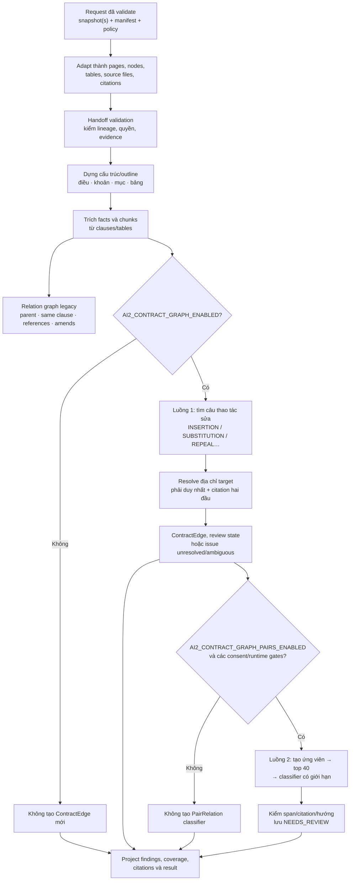
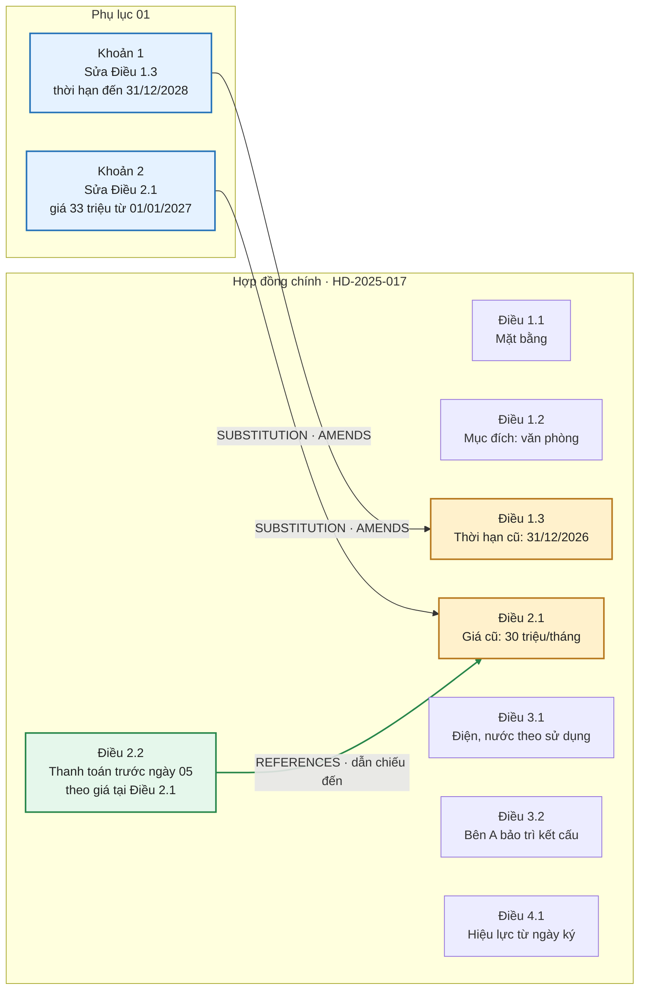

# Luồng hợp đồng từ OCR AI1 đến AI2 Contract Graph

**Phạm vi:** mô tả luồng theo code và processing contracts hiện có trong checkout `feature/ai2-contract-graph`. Ví dụ hợp đồng bên dưới là mô phỏng; graph không phải kết quả chạy trên tài liệu khách hàng.

## Tóm tắt một câu

AI1 biến PDF thành snapshot OCR/layout có trang, dòng, bảng và tọa độ; Backend xác nhận tài liệu thuộc hồ sơ, gắn vai trò hợp đồng chính/phụ lục và gửi snapshot kèm policy cho AI2; AI2 dựng lại cấu trúc điều khoản, tìm facts/quan hệ, tạo cạnh sửa đổi hoặc cặp quan hệ cần review, rồi trả đề xuất có citations. Backend xác minh snapshot/citation và lưu kết quả review.

## 1. Luồng đầu-cuối

```mermaid
sequenceDiagram
  autonumber
  actor User as Người dùng
  participant BE as Backend
  participant AI1 as AI1 OCR
  participant Obj as MinIO
  participant AI2 as AI2
  participant DB as PostgreSQL

  User->>BE: Tải hợp đồng PDF và phụ lục
  BE->>DB: Lưu dossier, tài liệu, role/manifest, pipeline run
  BE->>AI1: Kafka ai1.ocr.command + URL đọc PDF/ghi kết quả
  AI1->>Obj: Có thể tải PDF nguồn và ghi OCR result lớn
  AI1-->>BE: Kafka ai1.ocr.completed + snapshot hoặc result_ref
  BE->>BE: Kiểm tra run/document, schema, snapshot digest, quyền thuộc dossier
  BE->>DB: Lưu snapshot OCR bất biến, chờ đủ tài liệu đã chọn
  BE->>BE: Build be.ai2.processing.request.v1 từ snapshots + manifest
  BE->>AI2: POST /jobs/idp (code Backend hiện gọi submit rồi poll)
  AI2->>AI2: Validate/adapt snapshot, dựng evidence nodes và chạy pipeline
  AI2->>AI2: Phân tích tường minh, quan hệ ngầm nếu flags/gates cho phép
  AI2->>DB: Lưu job/snapshot, contract_edges và pair_relations ở schema ai2 (khi các flow chạy)
  AI2-->>BE: ai2.be.processing.result.v1: facts/findings/citations/coverage
  BE->>BE: Xác nhận result khớp request và mọi citation id resolve
  BE->>DB: Lưu đề xuất, findings, review items; chuyển hồ sơ chờ review
```

Transport cần đọc đúng theo code đang triển khai: AI1 OCR được Backend điều phối qua Kafka. Backend worker trong `backend/src/contract_intelligence/worker.py` gọi `submit_ai2_processing` rồi `poll_ai2_processing` qua HTTP; AI2 cũng có `kafka_idp_worker.py`, nhưng đó là một đường xử lý khác và hiện có kiểm tra giới hạn chỉ nhận đúng một member `body`. Trước khi bật graph đa tài liệu trên môi trường deploy, cần xác nhận đường vận chuyển thực tế và bỏ/điều chỉnh giới hạn đó nếu đường Kafka được dùng.

## 2. AI1 OCR tạo gì?

AI1 nhận một PDF/tài liệu và tạo `ai1.snapshot.v1`. Snapshot là bản evidence đã gắn version/digest của tài liệu, không phải kết luận AI2. Nội dung quan trọng gồm:

| Thành phần | Ví dụ | AI2/Backend dùng làm gì |
|---|---|---|
| Định danh | `snapshot_id`, `document_id`, `dossier_id`, `run_id` | Ghép đúng trang OCR vào đúng tài liệu/lần chạy/hồ sơ |
| Nguồn và phiên bản | `source_digest`, `created_at`, `execution`, `producer` | Phát hiện snapshot thay đổi; tái lập cùng input |
| Trang | `page_no`, `page_revision_id`, `input_type`, `status`, `raw_text_digest` | Chia evidence theo trang và kiểm tra citation version |
| Dòng và từ | `lines[].line_id`, `raw_text`, `bbox`, `words[]`, confidence/geometry metadata | Khôi phục đoạn, vị trí và citation để click về PDF |
| Bảng | `tables[].cells[]`, text, hàng/cột, bbox/line ids | Trích facts dạng bảng và trỏ về đúng ô khi có evidence |
| Chất lượng | OCR confidence, coverage, warnings | Giữ thông tin trang thiếu/chất lượng thấp để review |

Nếu kết quả lớn, AI1 có thể ghi JSON lên MinIO và gửi `result_ref` kèm URI/hash/bytes. Backend chỉ tải object đúng URI đã phát hành cho document/run và kiểm tra kích thước/hash trước khi nhận.

### Hình dung snapshot OCR của một câu

```text
PDF trang 3
  └─ line_id: p3-l18
      raw_text: "Thời hạn thuê đến hết ngày 31/12/2026."
      bbox: [x1, y1, x2, y2]     ← nếu AI1 có geometry hợp lệ
      page_revision_id: snap-body:page:3
```

AI1 chưa tạo cạnh `Phụ lục → Điều 1.3`. Nó chỉ báo “dòng chữ này nằm ở tài liệu/trang/vị trí nào”.

## 3. Backend làm gì trước khi gửi AI2?

Backend sở hữu ranh giới hồ sơ:

1. Nhận OCR event, kiểm tra event thuộc run/document hiện tại, snapshot hợp lệ và document nằm trong dossier.
2. Lưu snapshot vào pipeline run. Dùng manifest đã xác nhận để biết file nào được đưa vào, file nào là `body` (hợp đồng chính), file nào là `annex`.
3. Chỉ khi snapshot của các tài liệu được chọn đã sẵn sàng, build request canonical `be.ai2.processing.request.v1`.
4. Đính kèm `snapshots[]`, `snapshot_identities[]` có source/snapshot digest, `dossier_members[]`, `role_relation_map[]` như `ANNEX_OF`, `request_id`, `idempotency_key`, `attempt`, ngân sách và `service_envelope` ký.
5. Gửi AI2 và chờ kết quả. Khi retry AI2, Backend tăng `attempt` nhưng có thể tái sử dụng OCR snapshot; retry AI2 không tự OCR lại PDF.

Ví dụ rút gọn cho hồ sơ mẫu:

```json
{
  "schema_version": "be.ai2.processing.request.v1",
  "request_id": "run-017:ai2",
  "idempotency_key": "run-017:ai2",
  "attempt": 1,
  "dossier_id": "dossier-017",
  "snapshots": ["<snapshot hợp đồng chính>", "<snapshot phụ lục 01>"],
  "snapshot_identities": ["<snapshot id + source digest + snapshot digest>"],
  "dossier_members": [
    {"document_id": "doc-017", "snapshot_id": "snap-017", "role": "body"},
    {"document_id": "doc-017-a1", "snapshot_id": "snap-017-a1", "role": "annex"}
  ],
  "role_relation_map": [
    {"relation_type": "ANNEX_OF", "member_id": "member-a1", "related_member_id": "member-body"}
  ],
  "policy_flags": {
    "egress_allowed": false,
    "budget_limits": {"max_processing_seconds": 300, "max_llm_calls": 20}
  },
  "service_envelope": "<tenant, scope, expiry, payload hash, HMAC>"
}
```

Đây là sơ đồ shape để đọc, không phải payload đầy đủ hợp lệ: các giá trị snapshot/digest/HMAC được lược bỏ. Canonical request hiện giới hạn 1–6 snapshots, đúng một `body`; quan hệ hồ sơ `ANNEX_OF` do Backend/manifest xác định, AI2 không tự đổi role.

## 4. AI2 nhận request và tạo evidence nội bộ

Ở ranh giới nhận, AI2 kiểm tra schema, membership, digest, body/annex identity và policy. Adapter biến các snapshot thành một `DossierRecord` nội bộ gồm:

- `SourceFile` cho từng tài liệu, giữ role body/annex và digest;
- `PageSnapshot` cho trang, OCR lines, bảng và thông tin geometry;
- evidence nodes/structural nodes có node ID, text, parent/child, loại node, địa chỉ điều/khoản nếu khôi phục được;
- citations tạo được từ node + page revision + text span/line/bbox;
- dossier graph/role information để resolver biết node nào nằm trong tài liệu nào.

AI2 nối các snapshot thành một cấu trúc dossier rồi dựng outline/units từ evidence. Nó không lấy PDF gốc làm văn bản prompt thay cho OCR evidence. Nếu OCR thiếu dòng, địa chỉ điều khoản mơ hồ hoặc citation không xác minh được, issue được giữ lại thay vì đoán node đích.

## 5. AI2 xử lý bên trong



### 5.1 Graph cấu trúc/dẫn chiếu

Relation graph legacy dựng các quan hệ như `PARENT_OF`, `SAME_CLAUSE`, `REFERENCES`, `AMENDS`, `DEFINES`. Ví dụ câu “theo mức giá tại Điều 2.1” trong Điều 2.2 tạo hướng dẫn chiếu từ node Điều 2.2 sang node Điều 2.1 nếu địa chỉ resolve được. Đây là liên kết để lần theo nội dung, tự nó không thay đổi Điều 2.1.

### 5.2 Luồng 1 — phụ lục sửa điều khoản tường minh

Parser đọc các câu như “Sửa Khoản 3 Điều 1…”, “Bổ sung Khoản…” hoặc “Bãi bỏ…”, trích operation và target address. Resolver tìm node mục tiêu trong đúng hồ sơ/tài liệu, xử lý ngữ cảnh Điều/Phụ lục; chỉ tạo edge khi target duy nhất và citations nguồn/đích dựng được. Nếu không unique thì tạo issue unresolved/ambiguous, không nối sang điều khoản phỏng đoán.

Một edge operation-first có dạng khái quát:

```text
source_node_id = đoạn thao tác trong phụ lục
op             = SUBSTITUTION
 target_address = Khoản 3 Điều 1
 target_node_id = node Khoản 3 Điều 1 trong hợp đồng gốc
source_citation = trích đoạn phụ lục có câu sửa đổi
 target_citation = trích đoạn điều khoản bị sửa
review_state    = NEEDS_REVIEW (theo mặc định/policy)
```

Mũi tên graph: **đoạn phụ lục tạo thay đổi → điều khoản bị tác động**. Khi chiếu sang Backend finding, quan hệ tương thích là `AMENDS`; operation chi tiết vẫn thuộc graph AI2.

### 5.3 Luồng 2 — ghép cặp quan hệ ngầm

Nếu không có thao tác sửa tường minh cho một cặp, candidate generator ghép từ các tín hiệu như `EXPLICIT_REF`, `REFERENCE_CUE`, `SAME_KEY`, `SAME_ARTICLE`, `VALUE_MISMATCH`; loại cặp đã xử lý ở luồng 1, node cha-con và dẫn chiếu văn bản ngoài; chấm điểm và giữ tối đa 40. Classifier có thể xem tối đa 8 cặp mỗi call, 5 call, nhưng chỉ khi consent, egress, model, budget và deadline cho phép.

Classifier trả nhãn `REFERENCE` (có hướng từ câu dẫn đến câu được dẫn), `GENERAL_SPECIFIC` (có hướng chung → riêng), `CONFLICT` (không hướng), `DUPLICATE` (không hướng). Span/citation phải được xác thực; relation lưu `NEEDS_REVIEW`. Candidate bị cắt hoặc không sinh ra thì classifier không thể xét cặp đó.

### 5.4 Flags và trạng thái mặc định

Trong source hiện tại, `AI2_CONTRACT_GRAPH_ENABLED` và `AI2_CONTRACT_GRAPH_PAIRS_ENABLED` mặc định `true`; full Compose profile cũng bật processing/query egress, query LLM/vector và vector recall. Luồng 2 vẫn qua consent chia sẻ nội dung theo từng hồ sơ, global egress cap, model, budget và timeout. Mặc định bật capability không chứng minh inference đã chạy hoặc pair relations đã được tạo; trạng thái môi trường deploy, quyền consent và readiness phải kiểm tra riêng.

## 6. Ví dụ graph của hợp đồng mẫu

### Hợp đồng chính `HD-2025-017`

- Điều 1.1: thuê mặt bằng Tầng 2, Tòa nhà An Bình.
- Điều 1.2: mục đích sử dụng làm văn phòng.
- Điều 1.3: thời hạn đến 31/12/2026.
- Điều 2.1: giá thuê 30 triệu đồng/tháng.
- Điều 2.2: thanh toán trước ngày 05 hằng tháng, theo mức giá tại Điều 2.1.
- Điều 3.1: điện, nước thanh toán theo lượng dùng thực tế.
- Điều 3.2: Bên A bảo trì kết cấu chính.
- Điều 4.1: hợp đồng có hiệu lực từ ngày ký.

### Phụ lục 01 (mô phỏng)

- Khoản 1: sửa Điều 1.3, thời hạn mới đến 31/12/2028.
- Khoản 2: sửa Điều 2.1, giá mới 33 triệu đồng/tháng từ 01/01/2027.



**Đọc graph:** mũi tên xanh từ Phụ lục 01 sửa hai node Điều 1.3 và Điều 2.1; mũi tên xanh lá từ Điều 2.2 dẫn sang Điều 2.1. Điều 2.1 vì vậy vừa bị sửa vừa được Điều 2.2 dẫn chiếu. Điều 1.1, 1.2, 3.1, 3.2, 4.1 vẫn là các node trong hợp đồng nhưng không có cạnh sửa đổi/dẫn chiếu nào được vẽ ở ví dụ này. Khung tài liệu chỉ gom nhóm để dễ nhìn; không khẳng định mọi quan hệ cha-con trong cây OCR đều là ContractEdge.

Toàn bộ điều khoản và số liệu graph này là **mô phỏng**. Một ví dụ phụ lục công khai thật được ghi riêng trong [minh họa hợp đồng và graph nhiều điều khoản](ai2-contract-graph-example-contract-annex.vi.md); không suy rộng nội dung của phụ lục thật thành toàn bộ hợp đồng gốc.

## 7. Đầu ra AI2 gửi Backend: có gì, thiếu gì cho Graph UI?

Envelope thành công là `ai2.be.processing.result.v1`. Nó bao gồm:

- `status`, `review_state`, lineage `input_snapshots[]`;
- `result.facts[]`, `findings[]`, `context_findings[]`, `events[]`;
- danh sách `citations[]` dùng chung bằng citation IDs;
- `index_contribution` gồm `state: propose`, chunks, issues, coverage, contract context.

Backend xác nhận result bám đúng request/snapshot identities và mọi citation ID phải resolve trong `citations[]`; sau đó persist proposal/review items và chuyển hồ sơ sang trạng thái chờ review. AI2 không phát bbox mới; geometry chỉ được chuyển tiếp từ OCR evidence.

**Giới hạn Graph UI hiện tại:** `job_result_to_wire()` không serialize danh sách `ContractEdge` hoặc `PairRelation` đầy đủ thành `result.edges[]`/`result.relations[]`. Operation edges được chiếu thành `context_findings` kiểu `AMENDMENT_SIGNAL`/`AMENDS`; pair classifier chỉ chiếu `CONFLICT` sang finding, còn các pair relations được ghi trong database AI2 (`ai2.contract_pair_relations`) và số đếm/labels có trong coverage. Contract edges cũng được ghi trong `ai2.contract_edges`. Do đó, chỉ đọc result Backend hiện có sẽ chưa đủ để vẽ graph đầy đủ gồm mọi raw edges, pair relation và citation detail. Cần API có kiểm soát quyền để đọc graph persist từ AI2 hoặc mở rộng result contract trước khi giao diện có thể vẽ đúng graph; đây là hạng mục trong [kế hoạch Graph UI/deploy](AI2-GRAPH-DEVELOP-DEPLOY-UI-PLAN.vi.md).

## 8. Điều AI2 không khẳng định

- Một cạnh `AMENDS` không tự chứng minh điều khoản mới có hiệu lực hay điều khoản cũ đã mất hiệu lực.
- `REFERENCE` chỉ là dẫn chiếu/quan hệ văn bản; không đồng nghĩa sửa đổi.
- Không có cạnh/finding không chứng minh hợp đồng không có quan hệ; có thể node hoặc cặp chưa được nhận diện, không resolve, bị giới hạn candidate, feature đang OFF hoặc evidence/citation chưa đủ.
- Findings, graph edges và pair relations đều là dữ liệu đề xuất cần review, không phải tư vấn hoặc phán quyết pháp lý.

## 9. Tài liệu và code source-of-truth

- [Snapshot AI1 → Backend/AI2 schema](../contracts/ai1.snapshot.v1.schema.json)
- [Canonical request Backend → AI2](../contracts/be.ai2.processing.request.v1.schema.json)
- [Canonical result AI2 → Backend](../contracts/ai2.be.processing.result.v1.schema.json)
- [Processing contract](../contracts/BE-AI2-PROCESSING-CONTRACT.vi.md)
- [Kafka OCR contract AI1 ↔ Backend](../DOC-05d-kafka-ai1-ocr-contract.md)
- [Backend request builder](../../backend/src/contract_intelligence/shared/ai/canonical_processing.py)
- [Backend AI2 submit/poll adapter](../../backend/src/contract_intelligence/infrastructure/ai_adapters.py)
- [AI2 snapshot/request adapter](../../ai-service/app/pipeline/ai1_snapshot_adapter.py)
- [AI2 pipeline](../../ai-service/app/pipeline/idp.py)
- [ContractEdge model](../../ai-service/app/contracts/contract_graph.py)
- [Operation-first graph builder](../../ai-service/app/pipeline/contract_graph/builder.py)
- [Pair candidate generator](../../ai-service/app/pipeline/contract_graph/pair_candidates.py)
- [Pair classifier/builder](../../ai-service/app/pipeline/contract_graph/pair_builder.py)
- [AI2 result wire serializer](../../ai-service/app/contracts/wire.py)
