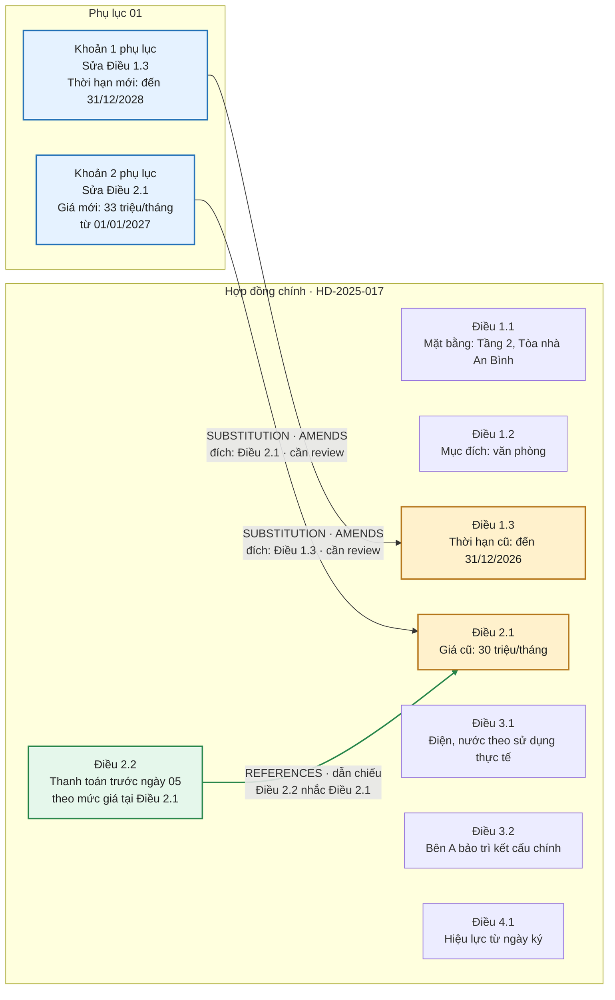
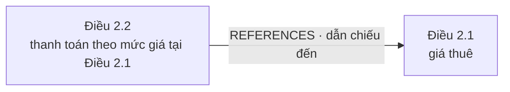
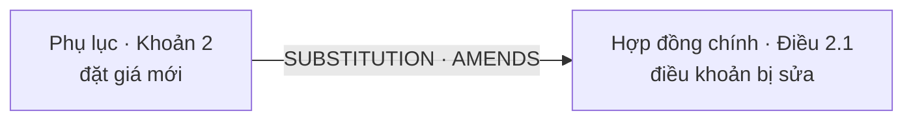
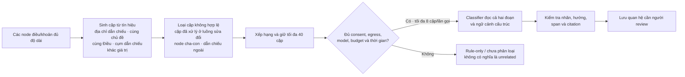
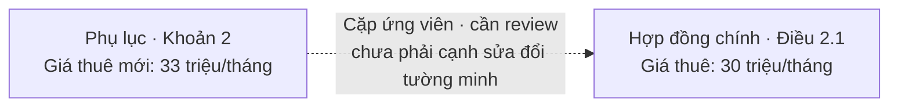

# AI2 Contract Graph: nhìn graph qua một hợp đồng nhiều điều khoản

> **Mục đích:** giúp hình dung graph của cả một bộ hợp đồng, thay vì chỉ một cặp điều khoản. Hợp đồng thuê mặt bằng dưới đây là **tình huống mô phỏng** để giải thích cấu trúc; nội dung và con số không trích từ hợp đồng thật.

## 1. Bộ hồ sơ mẫu

Hãy tưởng tượng hồ sơ có một hợp đồng chính và một phụ lục sửa đổi:

### Hợp đồng thuê mặt bằng `HD-2025-017`

| Điều khoản | Nội dung trong hợp đồng chính |
|---|---|
| Điều 1.1 — Mặt bằng | Bên A cho Bên B thuê mặt bằng tại Tầng 2, Tòa nhà An Bình. |
| Điều 1.2 — Mục đích | Bên B dùng mặt bằng làm văn phòng. |
| Điều 1.3 — Thời hạn | Từ 01/01/2025 đến hết 31/12/2026. |
| Điều 2.1 — Giá thuê | 30 triệu đồng/tháng. |
| Điều 2.2 — Ngày thanh toán | Thanh toán trước ngày 05 hằng tháng, theo mức giá tại Điều 2.1. |
| Điều 3.1 — Điện, nước | Bên B thanh toán theo lượng sử dụng và hóa đơn thực tế. |
| Điều 3.2 — Bảo trì | Bên A chịu trách nhiệm bảo trì kết cấu chính của tòa nhà. |
| Điều 4.1 — Hiệu lực | Hợp đồng có hiệu lực từ ngày hai bên ký. |

### Phụ lục 01 ký sau đó

Phụ lục ghi rõ:

1. “Sửa Khoản 3 Điều 1: thời hạn thuê đến hết ngày 31/12/2028.”
2. “Sửa Khoản 1 Điều 2: giá thuê là 33 triệu đồng/tháng kể từ ngày 01/01/2027.”

Vậy phụ lục tác động đến **hai điều khoản**. Các điều khoản về mục đích, ngày thanh toán, điện nước, bảo trì và hiệu lực vẫn nằm trong hồ sơ, nhưng phụ lục này không nhắc đến chúng.

## 2. Graph của toàn bộ hồ sơ



**Cách đọc hình:**

- Các ô trong khung **Hợp đồng chính** là những điều khoản AI2 đã nhận diện trong tài liệu gốc.
- Các ô xanh trong **Phụ lục 01** là đoạn tạo ra sửa đổi.
- Mũi tên đi từ đoạn sửa đổi sang điều khoản bị sửa: `Khoản 1 phụ lục → Điều 1.3`; `Khoản 2 phụ lục → Điều 2.1`.
- Mũi tên xanh lá `Điều 2.2 → Điều 2.1` là dẫn chiếu: Điều 2.2 nói “theo mức giá tại Điều 2.1”. Chiều mũi tên đi từ **điều khoản nhắc đến điều khác** sang **điều khoản được nhắc đến**.
- Hai điều khoản đích được tô vàng để dễ thấy phần bị tác động. Những ô còn lại vẫn thuộc hồ sơ, nhưng phụ lục mẫu không tạo cạnh tới chúng.
- Khung và cách nhóm điều khoản giúp người xem định vị tài liệu. Trong dữ liệu Contract Graph, hai mũi tên có nhãn mới là các cạnh sửa đổi đang minh họa; sơ đồ nhóm không khẳng định AI2 lưu một cạnh cho mọi quan hệ cha-con cấu trúc.

## 3. Trước và sau khi đọc phụ lục

| Điều khoản | Trong hợp đồng chính | Nội dung phụ lục đề xuất thay thế | Cạnh AI2 minh họa |
|---|---|---|---|
| Điều 1.3 — Thời hạn | Đến 31/12/2026 | Đến 31/12/2028 | `SUBSTITUTION`, từ Khoản 1 phụ lục đến Điều 1.3 |
| Điều 2.1 — Giá thuê | 30 triệu đồng/tháng | 33 triệu đồng/tháng từ 01/01/2027 | `SUBSTITUTION`, từ Khoản 2 phụ lục đến Điều 2.1 |
| Điều 2.2 → Điều 2.1 | “Theo mức giá tại Điều 2.1” | — | `REFERENCES`, Điều 2.2 dẫn đến Điều 2.1 |
| Điều 1.1, 1.2, 3.1, 3.2, 4.1 | Có trong hợp đồng | Phụ lục mẫu không đề cập | Không có cạnh sửa đổi từ phụ lục này |

AI2 ghi nhận quan hệ và trích dẫn để review. Hình này **không tự kết luận** rằng nội dung mới đã có hiệu lực, điều khoản nào thắng khi có tranh chấp, hoặc các điều khoản không được nhắc đến là không còn hiệu lực.

## 4. Dẫn chiếu khác gì với sửa đổi?

Giả sử Điều 2.2 viết: “Bên B thanh toán theo mức giá tại Điều 2.1.” Đây là quan hệ **dẫn chiếu**; nó giúp lần theo nội dung liên quan nhưng tự nó không sửa giá:



Phụ lục lại có thể tạo một cạnh khác đến chính Điều 2.1:



Do đó graph đầy đủ có thể có nhiều loại cạnh giữa các nút: **dẫn chiếu** nối nội dung viện dẫn đến nội dung được viện dẫn; **sửa đổi** nối phụ lục đến điều khoản bị tác động. Nếu một node vừa được phụ lục sửa vừa được điều khoản khác viện dẫn, cả hai cạnh cùng tồn tại. AI2 không nên gộp chúng thành một quan hệ duy nhất.

Trong codebase hiện tại, relation graph legacy có loại `REFERENCES`; lớp pair relation của Contract Graph dùng nhãn `REFERENCE` cho quan hệ cặp có hướng. `ContractEdge` operation-first dành cho thao tác sửa đổi (`SUBSTITUTION`, `INSERTION`...) và khi chiếu finding thì dùng `AMENDS`. Vì vậy `REFERENCE`/`REFERENCES` không phải một `op` sửa đổi.

## 5. Cơ chế ghép cặp để so sánh

AI2 không gửi mọi tổ hợp điều khoản lên model. Trước hết, candidate generator tạo một danh sách nhỏ các **cặp ứng viên** từ cấu trúc và tín hiệu trong câu chữ; sau đó mới xếp hạng và giới hạn danh sách:



Các tín hiệu hiện có trong candidate generator:

| Tín hiệu | Ví dụ / tác dụng |
|---|---|
| `EXPLICIT_REF` | Điều 2.2 ghi “theo mức giá tại Điều 2.1”; resolver phải tìm được duy nhất Điều 2.1. Đây là tín hiệu mạnh nhất trong các nguồn hiện có. |
| `REFERENCE_CUE` | Cụm như “nêu trên”, “theo quy định về …” có thể ghép tới vài node cùng chủ đề ở phía trước. |
| `SAME_KEY` | Hai điều khoản ở các Điều khác nhau cùng nói về chủ đề lexicon như giá, thanh toán, thời hạn, chấm dứt. |
| `SAME_ARTICLE` | Các khoản trong cùng Điều được đưa vào làm ứng viên, ưu tiên khoản kề nhau. |
| `VALUE_MISMATCH` | Tín hiệu thử nghiệm có thể đề xuất hai câu cùng chủ đề nhưng mang giá trị số khác nhau. |

Ứng viên được chấm điểm theo nguồn: `EXPLICIT_REF` 4 điểm, `REFERENCE_CUE` 3, `VALUE_MISMATCH` 3, `SAME_KEY` 2, `SAME_ARTICLE` 1; khoản kề nhau và cặp hợp đồng–phụ lục có thể được cộng điểm ưu tiên. Cặp đã được luồng sửa đổi tường minh xử lý, cặp node cha-con và dẫn chiếu ra văn bản ngoài bị loại. Từ các cặp còn lại, hệ thống giữ tối đa **40 cặp/hồ sơ**; classifier xử lý tối đa **8 cặp/lần gọi, 5 lần gọi**.

Trong hợp đồng mẫu:

- `Điều 2.2 ↔ Điều 2.1`: được ghép nhờ `EXPLICIT_REF`. Nếu nội dung xác nhận đây là dẫn chiếu và xác định được điều khoản nhắc đến, kết quả có hướng **Điều 2.2 → Điều 2.1**, nhãn `REFERENCE`.
- `Phụ lục Khoản 2 ↔ Điều 2.1`: phụ lục đã nói rõ “sửa Khoản 1 Điều 2”, nên cặp này thuộc luồng sửa đổi tường minh (`SUBSTITUTION · AMENDS`) và bị loại khỏi luồng ghép cặp quan hệ ngầm để tránh tạo hai kết quả trùng.
- Các điều khoản chỉ cùng chủ đề có thể thành ứng viên `SAME_KEY`, nhưng cùng chủ đề tự nó chưa đủ để tạo một quan hệ.

Classifier xem nội dung hai phía, trả nhãn như `CONFLICT`, `DUPLICATE`, `GENERAL_SPECIFIC` hoặc `REFERENCE`; kiểm tra đảm bảo span có thật trong văn bản, citation hợp lệ và hướng được chỉ rõ khi cần. Quan hệ được lưu riêng với hai bằng chứng và `NEEDS_REVIEW`. Với `CONFLICT`/`DUPLICATE` không có hướng; `REFERENCE` hướng từ referrer đến node được dẫn. Không có candidate nghĩa là classifier chưa từng được hỏi về cặp đó; candidate bị cắt khỏi top 40 hoặc bị loại cũng có thể làm giảm recall.

Hai cờ `AI2_CONTRACT_GRAPH_ENABLED` và `AI2_CONTRACT_GRAPH_PAIRS_ENABLED` mặc định bật trong source hiện tại. Nếu operator tắt cờ, hoặc consent chia sẻ nội dung theo hồ sơ, egress, model, budget hay thời gian không đạt, classifier không được gọi; trạng thái đó không được diễn giải là hệ thống đã so sánh và kết luận hai điều khoản không liên quan.

## 6. Một cạnh sửa đổi trông như thế nào trong dữ liệu

Ví dụ cạnh nối Khoản 1 phụ lục đến Điều 1.3. ID, snapshot và citation dưới đây là chỗ giữ chỗ để minh họa cấu trúc, không phải output chạy thật:

```json
{
  "edge_id": "cedge:<id-theo-snapshot>",
  "op": "SUBSTITUTION",
  "source_node_id": "node-khoan-1-phu-luc",
  "target_node_id": "node-dieu-1-3-hop-dong",
  "target_address": "Khoản 3 Điều 1",
  "anchor_node_id": null,
  "method": "EXACT",
  "support": "EXPLICIT_TEXT",
  "standard": true,
  "implicit": false,
  "new_text": "Thời hạn thuê đến hết ngày 31/12/2028",
  "review_state": "NEEDS_REVIEW",
  "source_snapshot_digest": "<snapshot-digest>",
  "source_citation": {
    "node_id": "node-khoan-1-phu-luc",
    "page_revision_id": "<page-revision-id>",
    "text_span": "Sửa Khoản 3 Điều 1: thời hạn thuê đến hết ngày 31/12/2028"
  },
  "target_citation": {
    "node_id": "node-dieu-1-3-hop-dong",
    "page_revision_id": "<page-revision-id>",
    "text_span": "Thời hạn thuê từ 01/01/2025 đến hết 31/12/2026"
  }
}
```

`op` mô tả thao tác trong AI2. Khi chiếu sang finding của backend, loại quan hệ tương thích là `AMENDS`; subtype thao tác vẫn có thể được dùng trong phần chi tiết/review của graph UI.

## 7. Nếu phụ lục không ghi địa chỉ điều khoản

Nếu phụ lục chỉ ghi “Giá thuê mới là 33 triệu đồng/tháng” mà không nói sửa Điều 2.1, AI2 không được tự biến phỏng đoán thành cạnh `AMENDS`. Luồng quan hệ ngầm có thể đề xuất cặp đoạn để người review kiểm tra:



Các nhãn quan hệ ngầm như `CONFLICT`, `REFERENCE`, `GENERAL_SPECIFIC`, `DUPLICATE` là quan hệ cặp riêng. Chúng cần hiển thị khác cạnh sửa đổi tường minh và luôn giữ trạng thái cần review.

## 8. Liên hệ với phụ lục công khai ở ví dụ trước

Một hồ sơ công khai của UBND tỉnh Nghệ An có đính kèm **Phụ lục 01/2020/PLHĐ-TĐ** của Hợp đồng thuê đất số **04/HĐ-TĐ**, ký ngày **11/11/2019**. Phụ lục ghi sửa Khoản 3 Điều 1; nội dung mới được dẫn là **“Thời hạn thuê đất đến hết ngày 10/4/2070”**. [Mở PDF nguồn](https://datafiles.nghean.gov.vn/nan-ubnd/2298/quantritintuc20248/GPMT_Trang_trai_giong_nuoi_trong_thuy_san_1722915640638591416785065020.pdf).

Đó là ví dụ thật về một địa chỉ sửa đổi cụ thể. Tài liệu công khai đang dẫn không cho biết toàn văn hợp đồng gốc và những điều khoản còn lại, nên không thể dựng trung thực graph đầy đủ của chính hợp đồng đó từ phần trích dẫn này. Graph nhiều điều khoản ở mục trên vì vậy là **hợp đồng mẫu hư cấu** để giải thích hình dạng tổng thể.

## 9. Điều gì cần có trên giao diện

Một màn hình dễ hiểu nên có ba vùng liên kết với nhau:

1. **Graph hồ sơ:** nhóm nút theo hợp đồng chính/phụ lục; mũi tên có hướng và nhãn thao tác/quan hệ.
2. **Danh sách điều khoản:** cho phép tìm và chọn điều khoản khi graph nhiều nút; tô sáng điều khoản được chọn trên graph.
3. **Bảng chi tiết bằng chứng:** khi chọn mũi tên, hiện trích đoạn nguồn và đích, tài liệu/trang, địa chỉ target và trạng thái review; có thể mở đúng vị trí trong PDF.

Cần có chú giải màu/nét, bộ lọc theo tài liệu và loại quan hệ, trạng thái graph trống/lỗi/runtime OFF, cùng một dạng danh sách dùng được bằng bàn phím và trình đọc màn hình. Graph lớn nên mở rộng theo từng tài liệu hoặc điều khoản thay vì vẽ dồn tất cả nút cùng lúc.

## 10. Trạng thái thực tế và tài liệu kỹ thuật

Sơ đồ ở trên là tài liệu hướng dẫn, không phải kết quả chạy AI2. Trong source hiện tại, `AI2_CONTRACT_GRAPH_ENABLED` và `AI2_CONTRACT_GRAPH_PAIRS_ENABLED` mặc định bật; operator vẫn có thể override và cấu hình thực tế của môi trường deploy phải được kiểm tra riêng.

- [Kiểu dữ liệu cạnh](../../ai-service/app/contracts/contract_graph.py)
- [Luồng sửa đổi tường minh](AI2-19-contract-graph-operation-first.vi.md)
- [Quan hệ ngầm theo cặp](AI2-20-contract-graph-pairs.vi.md)
- [Kế hoạch tích hợp develop, deploy và Graph UI](AI2-GRAPH-DEVELOP-DEPLOY-UI-PLAN.vi.md)
