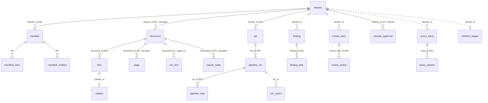

# 02 · Thiết kế Cơ sở dữ liệu (Database Schema)

| Thuộc tính | Nội dung |
|---|---|
| Người phụ trách | Chương (BE) |
| Phối hợp | Đức Dũng (AI1), Văn Dũng (AI2) |
| Cập nhật | 19/10/2026 |
| Phiên bản schema | Backend `v25__revoked_session` · AI2 `0009_dossier_purge` |
| Chi tiết từng bảng | [02b-csdl-chi-tiet.md](02b-csdl-chi-tiet.md) (sinh tự động từ PostgreSQL) |

Tài liệu này giải thích dữ liệu được lưu ở đâu, các bảng thuộc nhóm nghiệp vụ nào, quan hệ giữa chúng, và các quy ước chung. Danh sách cột, kiểu, khoá, index và trigger của **61 bảng** nằm ở phụ lục [02b](02b-csdl-chi-tiet.md). Phụ lục đó được xuất từ một PostgreSQL đã chạy hết migration của backend và AI2, không chép từ tài liệu thiết kế cũ.

> `docs/DOC-04b-postgres-schema.sql` và `docs/DOC-04c-database-erd.md` (17/09/2026) là bản **thiết kế ban đầu**. Từ đó tới nay đã có 25 migration, nên hai tài liệu đó **không còn khớp** với database thật. Khi cần biết database đang có gì, dùng tài liệu này và phụ lục 02b.

---

## 1. Dữ liệu nằm ở đâu

| Kho | Công nghệ | Chứa gì | Ai ghi |
|---|---|---|---|
| Database `contract_intelligence`, schema `public` | PostgreSQL 16 + pgvector | Hồ sơ, tài liệu, kết quả OCR, điều khoản, fact, finding, thẩm định, phê duyệt, nhật ký | Backend (role `ci`) |
| Database `contract_intelligence`, schema `ai2` | cùng PostgreSQL | Snapshot truy vấn, vector, graph hợp đồng, vết xử lý, job AI2 | AI2 (role `ai2`, chỉ có quyền trên schema `ai2`) |
| Database `keycloak` | PostgreSQL 16 (instance riêng) | Người dùng, mật khẩu (hash), role, phiên đăng nhập | Keycloak |
| Bucket `dossiers` | MinIO (S3) | File PDF gốc, ảnh render trang, kết quả OCR lớn của AI1 (`result_ref`) | Backend, AI1 |

Trên production (AWS Sydney):
- Hai PostgreSQL chạy trên máy **`ci-db`** (t4g.small), chỉ nghe trên IP nội bộ: backend ở cổng 5432, Keycloak ở cổng 5433. Security group chỉ cho máy `ci-app` vào.
- MinIO chạy trên `ci-app`, không mở ra Internet.
- Cách backup và khôi phục: xem [11 · Tài liệu Quản trị viên](11-admin-guide.md) và `deploy/README.md`.

Chuỗi kết nối, lấy từ `deploy/compose.prod.yml`; mật khẩu nằm trong `deploy/.env.prod`, **không có trong repo**:
- Backend: `postgresql+asyncpg://ci:<BACKEND_DB_PASSWORD>@<BACKEND_DB_HOST>:5432/contract_intelligence`
- AI2: `postgresql+psycopg://ai2:<AI2_DB_PASSWORD>@<BACKEND_DB_HOST>:5432/contract_intelligence`

## 2. Các nhóm bảng (schema `public`)

| Nhóm | Bảng | Vai trò |
|---|---|---|
| **Hồ sơ và tài liệu** | `dossier` | Hồ sơ hợp đồng, gốc của mọi dữ liệu khác. Có `metadata` (JSON: tên, mã, chia sẻ, consent AI2…), `status`, `deleted_at` |
| | `document` | Một file PDF trong hồ sơ: vai trò `CONTRACT`/`ANNEX`, `order_index`, `blob_uri` (MinIO), `page_count`, `sha256` |
| | `batch` | Lô nhiều hồ sơ tải cùng lúc |
| | `manifest`, `manifest_item`, `manifest_relation` | Phân loại tài liệu (hợp đồng, phụ lục) và quan hệ giữa chúng; backend tự xác nhận khi tải lên |
| **Xử lý (pipeline)** | `job` | Một lượt xử lý hồ sơ; giữ `current_run_id`, trạng thái, lease cho worker |
| | `pipeline_run` | Một lần chạy 11 bước S0–S10; giữ kết quả AI2 (`ai2_result_json`, `ai2_job_status`…) |
| | `pipeline_step` | Trạng thái từng bước S0–S10, kèm `progress` |
| | `run_event` | Sự kiện tiến độ theo thứ tự commit, nguồn của SSE `/runs/{id}/events` |
| | `processed_event` | Khoá chống xử lý trùng message Kafka (idempotency) |
| | `reocr_request` | Yêu cầu OCR lại một số trang |
| **Kết quả OCR (AI1)** | `page` | Một trang: kích thước, xoay, ảnh render, `features` (trạng thái OCR, lỗi) |
| | `ocr_line` | Một dòng OCR: text, `bbox` theo hệ toạ độ CPS, vị trí ký tự trong tài liệu |
| | `doc_table` | Bảng phát hiện trong tài liệu |
| | `clause_node` | Cây điều khoản (Điều, Khoản, Điểm) của tài liệu |
| **Trích xuất và mâu thuẫn** | `fact`, `citation` | Dữ kiện pháp lý trích được và trích dẫn nguyên văn làm bằng chứng |
| | `finding`, `finding_side` | Mâu thuẫn hoặc phát hiện; mỗi `finding_side` là một phía (tài liệu, điều khoản, trích dẫn) |
| | `annex_link` | Liên kết phụ lục với hợp đồng (bất biến) |
| **Thẩm định và phê duyệt** | `review_item` | Việc cần người thẩm định xem; có `version` để chống sửa đè (optimistic concurrency) |
| | `review_action` | Từng thao tác thẩm định, **chỉ thêm, không sửa, không xoá** (trigger, mục 5) |
| | `dossier_approval` | Bản ký duyệt nội bộ, bất biến |
| | `external_approval_grant` | Quyền duyệt từ hệ thống ngoài (thiết kế cho DocuSign/SAP; chưa dùng) |
| **Hỏi đáp** | `query_trace` | Mỗi câu hỏi gửi AI2: snapshot, trạng thái, citation, quyết định ACL, độ trễ |
| | `query_answer` | Câu trả lời của mỗi `query_trace`, cho lịch sử hỏi đáp theo người dùng |
| **Người dùng và phiên** | `app_user` | Bản sao người dùng Keycloak (tenant, role), để tra cứu và lọc nhanh |
| | `revoked_session` | Phiên Keycloak đã kết thúc (back-channel logout); token của phiên đó bị từ chối tới `expires_at` |
| **Nhật ký và vận hành** | `audit_event` | Nhật ký kiểm toán, chỉ thêm (trigger) |
| | `activity_event` | Dòng hoạt động hiển thị ở trang Quản trị |
| | `service_log_event` | Log chuẩn hoá của Backend, AI2, Frontend cho trang Nhật ký |
| | `deletion_ledger` | Mỗi hồ sơ người dùng yêu cầu xoá: thời điểm tombstone, trạng thái purge, bằng chứng đã xoá |
| **Từ điển theo tenant** | `tenant_lexicon_*` (6 bảng) | Từ đồng nghĩa và thuật ngữ riêng của tenant cho AI2: phiên bản, đề xuất, phân công, kiểm toán |
| **Tối ưu (chưa dùng)** | `optimization_campaign`, `_candidate`, `_experiment` | Khung benchmark prompt/heuristic theo DOC-04; chưa có màn hình dùng |
| Hệ thống | `alembic_version` | Phiên bản migration hiện tại |

> **PR #149** (đang chờ review, tải hồ sơ theo khúc, #145) thêm hai bảng `upload_session` và `upload_session_chunk` (migration `v26`). Khi PR đó merge, chạy lại script ở mục 6 để cập nhật phụ lục 02b.

## 3. Quan hệ chính

Sơ đồ dưới đây chỉ gồm các bảng nghiệp vụ chính. Đường liền là khoá ngoại có trong database; đường đứt là liên kết theo cột ID mà không có khoá ngoại.



Toàn bộ 20 khoá ngoại có trong database được vẽ ở phụ lục [02b](02b-csdl-chi-tiet.md), theo từng schema.

**Vì sao nhiều liên kết không có khoá ngoại:**
- **Bảng nhật ký phải sống lâu hơn dữ liệu chúng ghi lại** (`audit_event`, `review_action`, `query_trace`, `deletion_ledger`): khoá ngoại sẽ chặn hoặc kéo xoá theo khi xoá hồ sơ.
- **Kết quả OCR và AI được ghi bởi nhiều tiến trình** (worker Kafka, AI2) theo thứ tự không cố định. Tính toàn vẹn do code đảm bảo, theo `tenant_id` và `run_id`.

## 4. Schema `ai2` (AI2)

AI2 chỉ có quyền trên schema `ai2` (role `ai2`, #52). AI2 đọc dữ liệu của backend qua **snapshot** do backend gửi, không đọc thẳng các bảng `public`.

| Nhóm | Bảng | Vai trò |
|---|---|---|
| Job xử lý | `jobs` | Job tìm mâu thuẫn (`/jobs/idp`) và trạng thái |
| | `durable_runs`, `durable_checkpoints`, `durable_events`, `durable_audit`, `durable_outbox` | Chạy job bền vững: điểm dừng, sự kiện, kiểm toán, outbox gửi kết quả |
| Truy vấn | `dossier_query_snapshots` | Snapshot nội dung hồ sơ AI2 dùng để trả lời câu hỏi (theo `snapshot_digest`) |
| | `vector_segments` | Đoạn văn kèm embedding (pgvector) cho truy xuất ngữ nghĩa |
| | `sessions`, `session_blobs` | Phiên làm việc và file tạm của AI2 |
| Graph hợp đồng | `contract_edges`, `contract_pair_relations` | Quan hệ sửa đổi, thay thế giữa điều khoản, và cặp điều khoản đã so sánh |
| | `contract_graph_write_receipts` | Biên nhận mỗi lần ghi graph theo snapshot (chống ghi trùng hoặc lẫn bản) |
| | `ai2_processing_trace_events` | Vết xử lý từng bước của AI2, hiện ở "Vết xử lý" |
| Bảo mật và xoá | `service_nonces` | Nonce của request HMAC backend→AI2, chống gửi lại |
| | `dossier_resource_refs`, `dossier_tombstones` | Theo dõi dữ liệu AI2 của từng hồ sơ để xoá sạch khi backend xoá hồ sơ (#131) |

Chi tiết các bảng này do Văn Dũng duy trì; phụ lục 02b có cấu trúc đầy đủ.

## 5. Quy ước chung

- **Khoá chính:** `text`, dạng ULID có tiền tố theo loại, ví dụ `dos_…` (hồ sơ), `doc_…` (tài liệu), `job_…`, `run_…`. Sinh trong code (`shared/base.py: new_ulid`), không dùng sequence.
- **Đa tenant:** gần như mọi bảng có `tenant_id`. Mọi truy vấn của backend lọc theo `tenant_id` lấy từ token (header `X-Tenant-Id` phải khớp claim). Database **không** dùng Row Level Security; việc cô lập tenant nằm ở code và được test (`tests/integration/test_tenant_isolation.py`).
- **Thời gian:** luôn `timestamp with time zone` (UTC).
- **Xoá hồ sơ:** hai bước.
  1. Đặt `dossier.deleted_at` và ghi `deletion_ledger` (tombstone): hồ sơ biến mất khỏi API ngay.
  2. Vòng bảo trì của API purge dữ liệu: các bảng liên quan, file MinIO, và dữ liệu AI2 (qua API của AI2).
- **Bảng bất biến (chỉ thêm):** trigger `forbid_mutation()` chặn `UPDATE`/`DELETE` trên 17 bảng:
  - kết quả xử lý: `ocr_line`, `clause_node`, `doc_table`, `fact`, `citation`, `finding`, `finding_side`, `annex_link`;
  - nhật ký: `audit_event`, `review_action`, `query_trace`, `dossier_approval`;
  - từ điển: 5 bảng `tenant_lexicon_*`.
  - Muốn đổi kết quả thì ghi bản mới theo `run_id` mới, không sửa bản cũ.
  - Riêng purge khi xoá hồ sơ tạm tắt trigger của nhóm kết quả xử lý **trong cùng transaction** để xoá (`DossierRepositoryImpl.delete` trong `contract/infrastructure/persistence/repository_impl.py`). Các bảng nhật ký vẫn giữ nguyên.
  - `TRUNCATE` không bị trigger chặn, nên chỉ dùng khi dọn database test.
- **Chống sửa đè:** `review_item.version` tăng mỗi lần sửa; request mang `base_version` cũ bị từ chối (`409`).
- **JSON:** cột JSON dùng `jsonb` trên PostgreSQL (`json` khi chạy test bằng SQLite).

## 6. Migration

| | Backend | AI2 |
|---|---|---|
| Thư mục | `backend/alembic/versions/` (`vNN__mo_ta.py`) | `ai-service/app/db/migrations/versions/` (`NNNN_mo_ta.py`) |
| Bảng phiên bản | `public.alembic_version` | `ai2.alembic_version` |
| Khi nào chạy | Tự động lúc backend khởi động (`alembic upgrade head` trong `main.py`) | Tự động lúc AI2 khởi động (`app/db/migrate.py`, có advisory lock) |

**Thêm một bảng hoặc cột (backend):**
1. Sửa ORM trong `infrastructure/persistence/` của bounded context tương ứng. Bảng mới thì thêm module vào `shared/persistence/orm_registry.py`.
2. Tạo file `backend/alembic/versions/vNN__ten.py`, với `down_revision` là bản cuối. Viết `upgrade()` an toàn khi chạy lại (kiểm `has_table`) và có `downgrade()`.
3. Thử trên PostgreSQL thật: `upgrade head`, `downgrade -1`, `upgrade head` (CI cũng chạy các test `test_postgres_*`).
4. Cập nhật phụ lục 02b như dưới.

**Cập nhật phụ lục 02b** (không sửa tay):

```bash
docker run -d --rm --name ci-pg-doc -e POSTGRES_USER=ci -e POSTGRES_PASSWORD=ci \
  -e POSTGRES_DB=contract_intel -p 55434:5432 pgvector/pgvector:pg16
docker exec ci-pg-doc psql -U ci -d contract_intel -c "CREATE EXTENSION vector"
cd backend && DATABASE_URL=postgresql+asyncpg://ci:ci@127.0.0.1:55434/contract_intel uv run alembic upgrade head
cd ../ai-service && uv run python -c "from sqlalchemy import create_engine; from app.db.migrate import migrate; migrate(create_engine('postgresql+psycopg://ci:ci@127.0.0.1:55434/contract_intel'))"
cd ../backend && uv run python scripts/export_schema_doc.py postgresql://ci:ci@127.0.0.1:55434/contract_intel ../docs/ban-giao/02b-csdl-chi-tiet.md
docker rm -f ci-pg-doc
```
