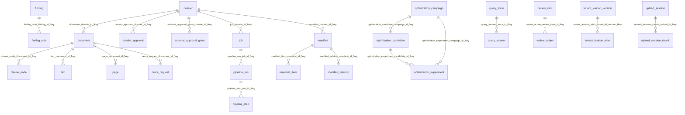

# Phụ lục 02b · Chi tiết schema cơ sở dữ liệu

> **Tệp sinh tự động** bởi `backend/scripts/export_schema_doc.py` từ PostgreSQL đã chạy hết migration. Không sửa tay: sửa migration rồi chạy lại script (cách chạy ở đầu script).

- PostgreSQL: `16.15 (Debian 16.15-1.pgdg12+2)`
- Backend (`public.alembic_version`): `v26__upload_session`
- AI2 (`ai2.alembic_version`): `0009_dossier_purge`
- Số bảng: `public` 45, `ai2` 18 (kể cả `alembic_version`)

Ký hiệu cột **Null**: `NOT NULL` hoặc để trống (cho phép NULL). Ràng buộc: `PK` khoá chính, `FK` khoá ngoại, `UQ` duy nhất, `CK` kiểm tra.

## Schema `public`: backend (Alembic `backend/alembic/versions`)

| Bảng | Số cột | Khoá ngoại tới |
|---|---|---|
| [`activity_event`](#public-activity_event) | 7 |  |
| [`alembic_version`](#public-alembic_version) | 1 |  |
| [`annex_link`](#public-annex_link) | 11 |  |
| [`app_user`](#public-app_user) | 9 |  |
| [`audit_event`](#public-audit_event) | 12 |  |
| [`batch`](#public-batch) | 11 |  |
| [`citation`](#public-citation) | 8 |  |
| [`clause_node`](#public-clause_node) | 15 | `document` |
| [`deletion_ledger`](#public-deletion_ledger) | 8 |  |
| [`doc_table`](#public-doc_table) | 11 |  |
| [`document`](#public-document) | 14 | `dossier` |
| [`dossier`](#public-dossier) | 17 |  |
| [`dossier_approval`](#public-dossier_approval) | 8 | `dossier` |
| [`external_approval_grant`](#public-external_approval_grant) | 17 | `dossier` |
| [`fact`](#public-fact) | 12 | `document` |
| [`finding`](#public-finding) | 14 |  |
| [`finding_side`](#public-finding_side) | 9 | `finding` |
| [`job`](#public-job) | 13 | `dossier` |
| [`manifest`](#public-manifest) | 8 | `dossier` |
| [`manifest_item`](#public-manifest_item) | 13 | `manifest` |
| [`manifest_relation`](#public-manifest_relation) | 7 | `manifest` |
| [`ocr_line`](#public-ocr_line) | 10 |  |
| [`optimization_campaign`](#public-optimization_campaign) | 8 |  |
| [`optimization_candidate`](#public-optimization_candidate) | 9 | `optimization_campaign` |
| [`optimization_experiment`](#public-optimization_experiment) | 10 | `optimization_campaign`, `optimization_candidate` |
| [`page`](#public-page) | 12 | `document` |
| [`pipeline_run`](#public-pipeline_run) | 29 | `job` |
| [`pipeline_step`](#public-pipeline_step) | 13 | `pipeline_run` |
| [`processed_event`](#public-processed_event) | 6 |  |
| [`query_answer`](#public-query_answer) | 6 | `query_trace` |
| [`query_trace`](#public-query_trace) | 16 |  |
| [`reocr_request`](#public-reocr_request) | 12 | `document` |
| [`review_action`](#public-review_action) | 12 | `review_item` |
| [`review_item`](#public-review_item) | 15 |  |
| [`revoked_session`](#public-revoked_session) | 4 |  |
| [`run_event`](#public-run_event) | 7 |  |
| [`service_log_event`](#public-service_log_event) | 14 |  |
| [`tenant_lexicon_alias`](#public-tenant_lexicon_alias) | 7 | `tenant_lexicon_version` |
| [`tenant_lexicon_assignment`](#public-tenant_lexicon_assignment) | 6 |  |
| [`tenant_lexicon_audit`](#public-tenant_lexicon_audit) | 7 |  |
| [`tenant_lexicon_head`](#public-tenant_lexicon_head) | 2 |  |
| [`tenant_lexicon_proposal`](#public-tenant_lexicon_proposal) | 8 |  |
| [`tenant_lexicon_version`](#public-tenant_lexicon_version) | 4 |  |
| [`upload_session`](#public-upload_session) | 12 |  |
| [`upload_session_chunk`](#public-upload_session_chunk) | 7 | `upload_session` |

### Sơ đồ khoá ngoại (`public`)

### `public.activity_event`

| Cột | Kiểu | Null | Mặc định | Ghi chú |
|---|---|---|---|---|
| `id` | `text` | NOT NULL |  |  |
| `tenant_id` | `text` | NOT NULL |  |  |
| `occurred_at` | `timestamp with time zone` | NOT NULL |  |  |
| `actor_display_name` | `text` |  |  |  |
| `title` | `text` | NOT NULL |  |  |
| `detail` | `text` |  |  |  |
| `kind` | `text` | NOT NULL |  |  |

Ràng buộc:

- PK `activity_event_pkey`: `PRIMARY KEY (id)`

Index:

- `CREATE INDEX ix_activity_event_tenant_id ON public.activity_event USING btree (tenant_id)`

### `public.alembic_version`

| Cột | Kiểu | Null | Mặc định | Ghi chú |
|---|---|---|---|---|
| `version_num` | `character varying(32)` | NOT NULL |  |  |

Ràng buộc:

- PK `alembic_version_pkc`: `PRIMARY KEY (version_num)`

### `public.annex_link`

| Cột | Kiểu | Null | Mặc định | Ghi chú |
|---|---|---|---|---|
| `id` | `text` | NOT NULL |  |  |
| `tenant_id` | `text` | NOT NULL |  |  |
| `dossier_id` | `text` | NOT NULL |  |  |
| `annex_document_id` | `text` | NOT NULL |  |  |
| `contract_document_id` | `text` | NOT NULL |  |  |
| `score` | `character varying` | NOT NULL |  |  |
| `annex_sequence` | `character varying` | NOT NULL | `'1'::character varying` |  |
| `effective_date` | `text` |  |  |  |
| `status` | `text` | NOT NULL |  |  |
| `citation_id` | `text` |  |  |  |
| `created_at` | `timestamp with time zone` | NOT NULL | `now()` |  |

Ràng buộc:

- PK `annex_link_pkey`: `PRIMARY KEY (id)`

Index:

- `CREATE INDEX ix_annex_link_annex_document_id ON public.annex_link USING btree (annex_document_id)`
- `CREATE INDEX ix_annex_link_contract_document_id ON public.annex_link USING btree (contract_document_id)`
- `CREATE INDEX ix_annex_link_dossier_id ON public.annex_link USING btree (dossier_id)`
- `CREATE INDEX ix_annex_link_tenant_id ON public.annex_link USING btree (tenant_id)`

Trigger:

- `CREATE TRIGGER trg_immutable_annex_link BEFORE DELETE OR UPDATE ON public.annex_link FOR EACH ROW EXECUTE FUNCTION forbid_mutation()`

### `public.app_user`

| Cột | Kiểu | Null | Mặc định | Ghi chú |
|---|---|---|---|---|
| `id` | `text` | NOT NULL |  |  |
| `tenant_id` | `text` | NOT NULL |  |  |
| `email` | `text` | NOT NULL |  |  |
| `display_name` | `text` | NOT NULL |  |  |
| `role` | `text` | NOT NULL |  |  |
| `is_active` | `boolean` | NOT NULL | `true` |  |
| `created_at` | `timestamp with time zone` | NOT NULL | `now()` |  |
| `updated_at` | `timestamp with time zone` | NOT NULL | `now()` |  |
| `keycloak_sub` | `text` | NOT NULL |  |  |

Ràng buộc:

- CK `ck_app_user_role`: `CHECK ((role = ANY (ARRAY['OPERATOR'::text, 'REVIEWER'::text, 'ADMINISTRATOR'::text])))`
- PK `app_user_pkey`: `PRIMARY KEY (id)`

Index:

- `CREATE INDEX ix_app_user_is_active ON public.app_user USING btree (is_active)`
- `CREATE UNIQUE INDEX ix_app_user_keycloak_sub ON public.app_user USING btree (keycloak_sub)`
- `CREATE INDEX ix_app_user_tenant ON public.app_user USING btree (tenant_id)`
- `CREATE UNIQUE INDEX ix_app_user_tenant_email ON public.app_user USING btree (tenant_id, email)`

### `public.audit_event`

| Cột | Kiểu | Null | Mặc định | Ghi chú |
|---|---|---|---|---|
| `id` | `text` | NOT NULL |  |  |
| `tenant_id` | `text` | NOT NULL |  |  |
| `occurred_at` | `timestamp with time zone` | NOT NULL |  |  |
| `actor_id` | `text` | NOT NULL |  |  |
| `action` | `text` | NOT NULL |  |  |
| `entity_type` | `text` | NOT NULL |  |  |
| `entity_id` | `text` | NOT NULL |  |  |
| `dossier_id` | `text` |  |  |  |
| `run_id` | `text` |  |  |  |
| `from_state` | `text` |  |  |  |
| `to_state` | `text` |  |  |  |
| `detail` | `text` |  |  |  |

Ràng buộc:

- PK `audit_event_pkey`: `PRIMARY KEY (id)`

Index:

- `CREATE INDEX ix_audit_event_action ON public.audit_event USING btree (action)`
- `CREATE INDEX ix_audit_event_dossier_id ON public.audit_event USING btree (dossier_id)`
- `CREATE INDEX ix_audit_event_run_id ON public.audit_event USING btree (run_id)`
- `CREATE INDEX ix_audit_event_tenant_id ON public.audit_event USING btree (tenant_id)`

Trigger:

- `CREATE TRIGGER trg_immutable_audit_event BEFORE DELETE OR UPDATE ON public.audit_event FOR EACH ROW EXECUTE FUNCTION forbid_mutation()`

### `public.batch`

| Cột | Kiểu | Null | Mặc định | Ghi chú |
|---|---|---|---|---|
| `id` | `text` | NOT NULL |  |  |
| `tenant_id` | `text` | NOT NULL |  |  |
| `name` | `text` | NOT NULL |  |  |
| `status` | `text` | NOT NULL | `'running'::text` |  |
| `total_dossiers` | `character varying` | NOT NULL | `'0'::character varying` |  |
| `succeeded` | `character varying` | NOT NULL | `'0'::character varying` |  |
| `failed` | `character varying` | NOT NULL | `'0'::character varying` |  |
| `pending_review` | `character varying` | NOT NULL | `'0'::character varying` |  |
| `total_cost_usd` | `character varying` | NOT NULL | `'0.0'::character varying` |  |
| `created_by` | `text` | NOT NULL |  |  |
| `created_at` | `timestamp with time zone` | NOT NULL | `now()` |  |

Ràng buộc:

- PK `batch_pkey`: `PRIMARY KEY (id)`

Index:

- `CREATE INDEX ix_batch_tenant_id ON public.batch USING btree (tenant_id)`

### `public.citation`

| Cột | Kiểu | Null | Mặc định | Ghi chú |
|---|---|---|---|---|
| `id` | `text` | NOT NULL |  |  |
| `tenant_id` | `text` | NOT NULL |  |  |
| `document_id` | `text` | NOT NULL |  |  |
| `quote` | `text` | NOT NULL |  |  |
| `quote_sha256` | `text` | NOT NULL |  |  |
| `doc_char_start` | `integer` | NOT NULL | `0` |  |
| `doc_char_end` | `integer` | NOT NULL | `0` |  |
| `segments` | `text` | NOT NULL |  |  |

Ràng buộc:

- PK `citation_pkey`: `PRIMARY KEY (id)`

Index:

- `CREATE INDEX ix_citation_document_id ON public.citation USING btree (document_id)`
- `CREATE INDEX ix_citation_quote_sha256 ON public.citation USING btree (quote_sha256)`
- `CREATE INDEX ix_citation_tenant_id ON public.citation USING btree (tenant_id)`

Trigger:

- `CREATE TRIGGER trg_immutable_citation BEFORE DELETE OR UPDATE ON public.citation FOR EACH ROW EXECUTE FUNCTION forbid_mutation()`

### `public.clause_node`

| Cột | Kiểu | Null | Mặc định | Ghi chú |
|---|---|---|---|---|
| `id` | `text` | NOT NULL |  |  |
| `tenant_id` | `text` | NOT NULL |  |  |
| `document_id` | `text` | NOT NULL |  |  |
| `parent_id` | `text` |  |  |  |
| `node_type` | `text` | NOT NULL |  |  |
| `label` | `text` | NOT NULL |  |  |
| `number` | `text` | NOT NULL |  |  |
| `title` | `text` | NOT NULL | `''::text` |  |
| `text` | `text` | NOT NULL |  |  |
| `page_start` | `integer` | NOT NULL |  |  |
| `page_end` | `integer` | NOT NULL |  |  |
| `confidence` | `character varying` | NOT NULL | `'0.0'::character varying` |  |
| `doc_char_start` | `integer` | NOT NULL | `0` |  |
| `doc_char_end` | `integer` | NOT NULL | `0` |  |
| `regions` | `text` |  |  |  |

Ràng buộc:

- FK `clause_node_document_id_fkey`: `FOREIGN KEY (document_id) REFERENCES document(id) ON DELETE CASCADE`
- PK `clause_node_pkey`: `PRIMARY KEY (id)`

Index:

- `CREATE INDEX ix_clause_node_document_id ON public.clause_node USING btree (document_id)`
- `CREATE INDEX ix_clause_node_parent_id ON public.clause_node USING btree (parent_id)`
- `CREATE INDEX ix_clause_node_tenant_id ON public.clause_node USING btree (tenant_id)`

Trigger:

- `CREATE TRIGGER trg_immutable_clause_node BEFORE DELETE OR UPDATE ON public.clause_node FOR EACH ROW EXECUTE FUNCTION forbid_mutation()`

### `public.deletion_ledger`

| Cột | Kiểu | Null | Mặc định | Ghi chú |
|---|---|---|---|---|
| `id` | `text` | NOT NULL |  |  |
| `tenant_id` | `text` | NOT NULL |  |  |
| `dossier_id` | `text` | NOT NULL |  |  |
| `requested_by` | `text` | NOT NULL |  |  |
| `tombstoned_at` | `timestamp with time zone` | NOT NULL | `now()` |  |
| `purge_status` | `text` | NOT NULL | `'pending'::text` |  |
| `purged_at` | `timestamp with time zone` |  |  |  |
| `evidence` | `jsonb` |  |  |  |

Ràng buộc:

- PK `deletion_ledger_pkey`: `PRIMARY KEY (id)`
- UQ `uq_deletion_ledger_dossier`: `UNIQUE (tenant_id, dossier_id)`

Index:

- `CREATE INDEX ix_deletion_ledger_dossier_id ON public.deletion_ledger USING btree (dossier_id)`
- `CREATE INDEX ix_deletion_ledger_tenant_id ON public.deletion_ledger USING btree (tenant_id)`

### `public.doc_table`

| Cột | Kiểu | Null | Mặc định | Ghi chú |
|---|---|---|---|---|
| `id` | `text` | NOT NULL |  |  |
| `tenant_id` | `text` | NOT NULL |  |  |
| `document_id` | `text` | NOT NULL |  |  |
| `page_no` | `integer` | NOT NULL |  |  |
| `bbox` | `text` | NOT NULL |  |  |
| `rows_count` | `integer` | NOT NULL |  |  |
| `cols_count` | `integer` | NOT NULL |  |  |
| `has_borders` | `character varying` | NOT NULL | `'true'::character varying` |  |
| `is_multi_page` | `boolean` | NOT NULL | `false` |  |
| `continued_from` | `text` |  |  |  |
| `cells` | `text` | NOT NULL |  |  |

Ràng buộc:

- PK `doc_table_pkey`: `PRIMARY KEY (id)`

Index:

- `CREATE INDEX ix_doc_table_document_id ON public.doc_table USING btree (document_id)`
- `CREATE INDEX ix_doc_table_tenant_id ON public.doc_table USING btree (tenant_id)`

Trigger:

- `CREATE TRIGGER trg_immutable_doc_table BEFORE DELETE OR UPDATE ON public.doc_table FOR EACH ROW EXECUTE FUNCTION forbid_mutation()`

### `public.document`

| Cột | Kiểu | Null | Mặc định | Ghi chú |
|---|---|---|---|---|
| `id` | `text` | NOT NULL |  |  |
| `tenant_id` | `text` | NOT NULL |  |  |
| `dossier_id` | `text` | NOT NULL |  |  |
| `role` | `text` | NOT NULL |  |  |
| `order_index` | `integer` | NOT NULL | `0` |  |
| `filename` | `text` | NOT NULL |  |  |
| `sha256` | `text` | NOT NULL |  |  |
| `blob_uri` | `text` |  |  |  |
| `file_size_bytes` | `integer` | NOT NULL | `0` |  |
| `page_count` | `integer` | NOT NULL | `0` |  |
| `lang_detected` | `text` | NOT NULL | `'vi'::text` |  |
| `signing_date` | `text` |  |  |  |
| `effective_date` | `text` |  |  |  |
| `created_at` | `timestamp with time zone` | NOT NULL | `now()` |  |

Ràng buộc:

- FK `document_dossier_id_fkey`: `FOREIGN KEY (dossier_id) REFERENCES dossier(id) ON DELETE CASCADE`
- PK `document_pkey`: `PRIMARY KEY (id)`
- UQ `uq_document_dossier_sha`: `UNIQUE (dossier_id, sha256)`

Index:

- `CREATE INDEX ix_document_dossier_id ON public.document USING btree (dossier_id)`
- `CREATE INDEX ix_document_dossier_order ON public.document USING btree (dossier_id, order_index)`
- `CREATE INDEX ix_document_tenant_id ON public.document USING btree (tenant_id)`

### `public.dossier`

| Cột | Kiểu | Null | Mặc định | Ghi chú |
|---|---|---|---|---|
| `id` | `text` | NOT NULL |  |  |
| `tenant_id` | `text` | NOT NULL |  |  |
| `name` | `text` | NOT NULL |  |  |
| `batch_id` | `text` |  |  |  |
| `status` | `text` | NOT NULL | `'uploaded'::text` |  |
| `has_conflicts` | `boolean` | NOT NULL | `false` |  |
| `is_locked` | `boolean` | NOT NULL | `false` |  |
| `is_approved` | `boolean` | NOT NULL | `false` |  |
| `checksum` | `text` |  |  |  |
| `metadata` | `json` |  |  |  |
| `deleted_at` | `timestamp with time zone` |  |  |  |
| `deleted_by` | `text` |  |  |  |
| `purge_status` | `text` |  |  |  |
| `purge_completed_at` | `timestamp with time zone` |  |  |  |
| `purge_error` | `text` |  |  |  |
| `created_at` | `timestamp with time zone` | NOT NULL | `now()` |  |
| `updated_at` | `timestamp with time zone` | NOT NULL | `now()` |  |

Ràng buộc:

- PK `dossier_pkey`: `PRIMARY KEY (id)`

Index:

- `CREATE INDEX ix_dossier_batch_id ON public.dossier USING btree (batch_id)`
- `CREATE INDEX ix_dossier_tenant_deleted_at ON public.dossier USING btree (tenant_id, deleted_at)`
- `CREATE INDEX ix_dossier_tenant_id ON public.dossier USING btree (tenant_id)`
- `CREATE INDEX ix_dossier_tenant_status ON public.dossier USING btree (tenant_id, status)`

### `public.dossier_approval`

| Cột | Kiểu | Null | Mặc định | Ghi chú |
|---|---|---|---|---|
| `id` | `text` | NOT NULL |  |  |
| `tenant_id` | `text` | NOT NULL |  |  |
| `dossier_id` | `text` | NOT NULL |  |  |
| `approved_by` | `text` | NOT NULL |  |  |
| `checksum` | `text` | NOT NULL |  |  |
| `comment` | `text` |  |  |  |
| `snapshot_uri` | `text` |  |  |  |
| `approved_at` | `timestamp with time zone` | NOT NULL | `now()` |  |

Ràng buộc:

- FK `dossier_approval_dossier_id_fkey`: `FOREIGN KEY (dossier_id) REFERENCES dossier(id) ON DELETE RESTRICT`
- PK `dossier_approval_pkey`: `PRIMARY KEY (id)`

Index:

- `CREATE INDEX ix_dossier_approval_dossier_id ON public.dossier_approval USING btree (dossier_id)`
- `CREATE INDEX ix_dossier_approval_tenant_id ON public.dossier_approval USING btree (tenant_id)`
- `CREATE UNIQUE INDEX uq_dossier_approval_dossier ON public.dossier_approval USING btree (dossier_id)`

Trigger:

- `CREATE TRIGGER trg_immutable_dossier_approval BEFORE DELETE OR UPDATE ON public.dossier_approval FOR EACH ROW EXECUTE FUNCTION forbid_mutation()`

### `public.external_approval_grant`

| Cột | Kiểu | Null | Mặc định | Ghi chú |
|---|---|---|---|---|
| `id` | `text` | NOT NULL |  |  |
| `tenant_id` | `text` | NOT NULL |  |  |
| `dossier_id` | `text` | NOT NULL |  |  |
| `token` | `text` | NOT NULL |  |  |
| `provider` | `text` | NOT NULL | `'docusign'::text` |  |
| `recipient_email` | `text` | NOT NULL |  |  |
| `recipient_name` | `text` |  |  |  |
| `status` | `text` | NOT NULL | `'pending'::text` |  |
| `external_reference_id` | `text` |  |  |  |
| `digital_signature_hash` | `text` |  |  |  |
| `signature_certificate` | `text` |  |  |  |
| `callback_url` | `text` |  |  |  |
| `expires_at` | `timestamp with time zone` | NOT NULL |  |  |
| `responded_at` | `timestamp with time zone` |  |  |  |
| `response_payload` | `text` |  |  |  |
| `created_by` | `text` | NOT NULL |  |  |
| `created_at` | `timestamp with time zone` | NOT NULL | `now()` |  |

Ràng buộc:

- FK `external_approval_grant_dossier_id_fkey`: `FOREIGN KEY (dossier_id) REFERENCES dossier(id) ON DELETE CASCADE`
- PK `external_approval_grant_pkey`: `PRIMARY KEY (id)`

Index:

- `CREATE INDEX ix_external_approval_grant_dossier_id ON public.external_approval_grant USING btree (dossier_id)`
- `CREATE INDEX ix_external_approval_grant_tenant_id ON public.external_approval_grant USING btree (tenant_id)`
- `CREATE UNIQUE INDEX ix_external_approval_grant_token ON public.external_approval_grant USING btree (token)`

### `public.fact`

| Cột | Kiểu | Null | Mặc định | Ghi chú |
|---|---|---|---|---|
| `id` | `text` | NOT NULL |  |  |
| `tenant_id` | `text` | NOT NULL |  |  |
| `document_id` | `text` | NOT NULL |  |  |
| `key` | `text` | NOT NULL |  |  |
| `fact_type` | `text` | NOT NULL |  |  |
| `raw_text` | `text` | NOT NULL |  |  |
| `normalized_value` | `text` | NOT NULL |  |  |
| `confidence` | `character varying` | NOT NULL | `'0.0'::character varying` |  |
| `extractor` | `text` | NOT NULL |  |  |
| `context_text` | `text` |  |  |  |
| `citation_id` | `text` | NOT NULL |  |  |
| `created_at` | `timestamp with time zone` | NOT NULL | `now()` |  |

Ràng buộc:

- FK `fact_document_id_fkey`: `FOREIGN KEY (document_id) REFERENCES document(id) ON DELETE CASCADE`
- PK `fact_pkey`: `PRIMARY KEY (id)`

Index:

- `CREATE INDEX ix_fact_document_id ON public.fact USING btree (document_id)`
- `CREATE INDEX ix_fact_key ON public.fact USING btree (key)`
- `CREATE INDEX ix_fact_tenant_id ON public.fact USING btree (tenant_id)`

Trigger:

- `CREATE TRIGGER trg_immutable_fact BEFORE DELETE OR UPDATE ON public.fact FOR EACH ROW EXECUTE FUNCTION forbid_mutation()`

### `public.finding`

| Cột | Kiểu | Null | Mặc định | Ghi chú |
|---|---|---|---|---|
| `id` | `text` | NOT NULL |  |  |
| `tenant_id` | `text` | NOT NULL |  |  |
| `dossier_id` | `text` | NOT NULL |  |  |
| `run_id` | `text` |  |  |  |
| `finding_type` | `text` | NOT NULL |  |  |
| `scope` | `text` | NOT NULL |  |  |
| `key_or_topic` | `text` | NOT NULL |  |  |
| `disposition` | `text` | NOT NULL |  |  |
| `severity` | `text` | NOT NULL |  |  |
| `confidence` | `character varying` | NOT NULL | `'0.0'::character varying` |  |
| `rationale` | `text` |  |  |  |
| `method` | `text` | NOT NULL |  |  |
| `trace_id` | `text` |  |  |  |
| `created_at` | `timestamp with time zone` | NOT NULL | `now()` |  |

Ràng buộc:

- PK `finding_pkey`: `PRIMARY KEY (id)`

Index:

- `CREATE INDEX ix_finding_dossier_id ON public.finding USING btree (dossier_id)`
- `CREATE INDEX ix_finding_run_id ON public.finding USING btree (run_id)`
- `CREATE INDEX ix_finding_tenant_id ON public.finding USING btree (tenant_id)`

Trigger:

- `CREATE TRIGGER trg_immutable_finding BEFORE DELETE OR UPDATE ON public.finding FOR EACH ROW EXECUTE FUNCTION forbid_mutation()`

### `public.finding_side`

| Cột | Kiểu | Null | Mặc định | Ghi chú |
|---|---|---|---|---|
| `id` | `text` | NOT NULL |  |  |
| `tenant_id` | `text` | NOT NULL |  |  |
| `finding_id` | `text` | NOT NULL |  |  |
| `side` | `text` | NOT NULL |  |  |
| `document_id` | `text` | NOT NULL |  |  |
| `fact_id` | `text` |  |  |  |
| `clause_node_id` | `text` |  |  |  |
| `citation_id` | `text` |  |  |  |
| `value_snapshot` | `text` |  |  |  |

Ràng buộc:

- FK `finding_side_finding_id_fkey`: `FOREIGN KEY (finding_id) REFERENCES finding(id) ON DELETE CASCADE`
- PK `finding_side_pkey`: `PRIMARY KEY (id)`

Index:

- `CREATE INDEX ix_finding_side_finding_id ON public.finding_side USING btree (finding_id)`
- `CREATE INDEX ix_finding_side_tenant_id ON public.finding_side USING btree (tenant_id)`
- `CREATE UNIQUE INDEX uq_finding_side_finding_side ON public.finding_side USING btree (finding_id, side)`

Trigger:

- `CREATE TRIGGER trg_immutable_finding_side BEFORE DELETE OR UPDATE ON public.finding_side FOR EACH ROW EXECUTE FUNCTION forbid_mutation()`

### `public.job`

| Cột | Kiểu | Null | Mặc định | Ghi chú |
|---|---|---|---|---|
| `id` | `text` | NOT NULL |  |  |
| `tenant_id` | `text` | NOT NULL |  |  |
| `dossier_id` | `text` | NOT NULL |  |  |
| `batch_id` | `text` |  |  |  |
| `status` | `text` | NOT NULL | `'uploaded'::text` |  |
| `has_conflicts` | `boolean` | NOT NULL | `false` |  |
| `current_run_id` | `text` |  |  |  |
| `error_code` | `text` |  |  |  |
| `error_detail` | `text` |  |  |  |
| `lease_owner` | `text` |  |  |  |
| `lease_expires_at` | `timestamp with time zone` |  |  |  |
| `created_at` | `timestamp with time zone` | NOT NULL | `now()` |  |
| `updated_at` | `timestamp with time zone` | NOT NULL | `now()` |  |

Ràng buộc:

- FK `job_dossier_id_fkey`: `FOREIGN KEY (dossier_id) REFERENCES dossier(id) ON DELETE CASCADE`
- PK `job_pkey`: `PRIMARY KEY (id)`

Index:

- `CREATE INDEX ix_job_dossier_id ON public.job USING btree (dossier_id)`
- `CREATE INDEX ix_job_lease_expires_at ON public.job USING btree (lease_expires_at)`
- `CREATE INDEX ix_job_queue_ready ON public.job USING btree (status, created_at)`
- `CREATE INDEX ix_job_tenant_id ON public.job USING btree (tenant_id)`

### `public.manifest`

| Cột | Kiểu | Null | Mặc định | Ghi chú |
|---|---|---|---|---|
| `id` | `text` | NOT NULL |  |  |
| `tenant_id` | `text` | NOT NULL |  |  |
| `dossier_id` | `text` | NOT NULL |  |  |
| `status` | `text` | NOT NULL | `'pending'::text` |  |
| `version` | `integer` | NOT NULL | `1` |  |
| `confirmed_at` | `timestamp with time zone` |  |  |  |
| `confirmed_by` | `text` |  |  |  |
| `created_at` | `timestamp with time zone` | NOT NULL | `now()` |  |

Ràng buộc:

- FK `manifest_dossier_id_fkey`: `FOREIGN KEY (dossier_id) REFERENCES dossier(id) ON DELETE CASCADE`
- PK `manifest_pkey`: `PRIMARY KEY (id)`
- UQ `manifest_dossier_id_key`: `UNIQUE (dossier_id)`

Index:

- `CREATE INDEX ix_manifest_tenant_id ON public.manifest USING btree (tenant_id)`

### `public.manifest_item`

| Cột | Kiểu | Null | Mặc định | Ghi chú |
|---|---|---|---|---|
| `id` | `text` | NOT NULL |  |  |
| `manifest_id` | `text` | NOT NULL |  |  |
| `document_id` | `text` |  |  |  |
| `filename` | `text` | NOT NULL |  |  |
| `doc_type` | `text` | NOT NULL |  |  |
| `document_number` | `text` |  |  |  |
| `sha256` | `text` |  |  |  |
| `confidence` | `character varying` | NOT NULL | `'0.0'::character varying` |  |
| `order_index` | `integer` | NOT NULL | `0` |  |
| `included` | `boolean` | NOT NULL | `true` |  |
| `page_count` | `integer` | NOT NULL | `0` |  |
| `file_size_bytes` | `integer` | NOT NULL | `0` |  |
| `created_at` | `timestamp with time zone` | NOT NULL | `now()` |  |

Ràng buộc:

- FK `manifest_item_manifest_id_fkey`: `FOREIGN KEY (manifest_id) REFERENCES manifest(id) ON DELETE CASCADE`
- PK `manifest_item_pkey`: `PRIMARY KEY (id)`

Index:

- `CREATE INDEX ix_manifest_item_manifest_id ON public.manifest_item USING btree (manifest_id)`

### `public.manifest_relation`

| Cột | Kiểu | Null | Mặc định | Ghi chú |
|---|---|---|---|---|
| `id` | `text` | NOT NULL |  |  |
| `manifest_id` | `text` | NOT NULL |  |  |
| `source_document_id` | `text` | NOT NULL |  |  |
| `target_document_id` | `text` | NOT NULL |  |  |
| `relation_type` | `text` | NOT NULL |  |  |
| `confirmation` | `text` | NOT NULL | `'unconfirmed'::text` |  |
| `created_at` | `timestamp with time zone` | NOT NULL | `now()` |  |

Ràng buộc:

- FK `manifest_relation_manifest_id_fkey`: `FOREIGN KEY (manifest_id) REFERENCES manifest(id) ON DELETE CASCADE`
- PK `manifest_relation_pkey`: `PRIMARY KEY (id)`

Index:

- `CREATE INDEX ix_manifest_relation_manifest_id ON public.manifest_relation USING btree (manifest_id)`
- `CREATE INDEX ix_manifest_relation_pair ON public.manifest_relation USING btree (manifest_id, source_document_id, target_document_id, relation_type)`

### `public.ocr_line`

| Cột | Kiểu | Null | Mặc định | Ghi chú |
|---|---|---|---|---|
| `id` | `text` | NOT NULL |  |  |
| `tenant_id` | `text` | NOT NULL |  |  |
| `document_id` | `text` | NOT NULL |  |  |
| `page_no` | `integer` | NOT NULL |  |  |
| `line_no` | `integer` | NOT NULL |  |  |
| `text` | `text` | NOT NULL |  |  |
| `bbox` | `text` | NOT NULL |  |  |
| `confidence` | `character varying` |  |  |  |
| `doc_char_start` | `integer` | NOT NULL | `0` |  |
| `doc_char_end` | `integer` | NOT NULL | `0` |  |

Ràng buộc:

- PK `ocr_line_pkey`: `PRIMARY KEY (id)`

Index:

- `CREATE INDEX ix_ocr_line_doc_page_line ON public.ocr_line USING btree (document_id, page_no, line_no)`
- `CREATE INDEX ix_ocr_line_document_id ON public.ocr_line USING btree (document_id)`
- `CREATE INDEX ix_ocr_line_tenant_id ON public.ocr_line USING btree (tenant_id)`

Trigger:

- `CREATE TRIGGER trg_immutable_ocr_line BEFORE DELETE OR UPDATE ON public.ocr_line FOR EACH ROW EXECUTE FUNCTION forbid_mutation()`

### `public.optimization_campaign`

| Cột | Kiểu | Null | Mặc định | Ghi chú |
|---|---|---|---|---|
| `id` | `text` | NOT NULL |  |  |
| `tenant_id` | `text` | NOT NULL |  |  |
| `name` | `text` | NOT NULL |  |  |
| `goal` | `text` | NOT NULL |  |  |
| `target_metric` | `text` | NOT NULL |  |  |
| `status` | `text` | NOT NULL | `'draft'::text` |  |
| `created_by` | `text` | NOT NULL |  |  |
| `created_at` | `timestamp with time zone` | NOT NULL | `now()` |  |

Ràng buộc:

- PK `optimization_campaign_pkey`: `PRIMARY KEY (id)`

Index:

- `CREATE INDEX ix_optimization_campaign_tenant_id ON public.optimization_campaign USING btree (tenant_id)`

### `public.optimization_candidate`

| Cột | Kiểu | Null | Mặc định | Ghi chú |
|---|---|---|---|---|
| `id` | `text` | NOT NULL |  |  |
| `tenant_id` | `text` | NOT NULL |  |  |
| `campaign_id` | `text` | NOT NULL |  |  |
| `name` | `text` | NOT NULL |  |  |
| `prompt_version` | `text` | NOT NULL |  |  |
| `hyperparameters` | `text` |  |  |  |
| `is_promoted` | `character varying` | NOT NULL | `'false'::character varying` |  |
| `metrics` | `text` |  |  |  |
| `created_at` | `timestamp with time zone` | NOT NULL | `now()` |  |

Ràng buộc:

- FK `optimization_candidate_campaign_id_fkey`: `FOREIGN KEY (campaign_id) REFERENCES optimization_campaign(id) ON DELETE CASCADE`
- PK `optimization_candidate_pkey`: `PRIMARY KEY (id)`

Index:

- `CREATE INDEX ix_optimization_candidate_campaign_id ON public.optimization_candidate USING btree (campaign_id)`
- `CREATE INDEX ix_optimization_candidate_tenant_id ON public.optimization_candidate USING btree (tenant_id)`

### `public.optimization_experiment`

| Cột | Kiểu | Null | Mặc định | Ghi chú |
|---|---|---|---|---|
| `id` | `text` | NOT NULL |  |  |
| `tenant_id` | `text` | NOT NULL |  |  |
| `campaign_id` | `text` | NOT NULL |  |  |
| `candidate_id` | `text` | NOT NULL |  |  |
| `benchmark_set_name` | `text` | NOT NULL |  |  |
| `status` | `text` | NOT NULL | `'queued'::text` |  |
| `results` | `text` |  |  |  |
| `started_at` | `timestamp with time zone` |  |  |  |
| `finished_at` | `timestamp with time zone` |  |  |  |
| `created_at` | `timestamp with time zone` | NOT NULL | `now()` |  |

Ràng buộc:

- FK `optimization_experiment_campaign_id_fkey`: `FOREIGN KEY (campaign_id) REFERENCES optimization_campaign(id) ON DELETE CASCADE`
- FK `optimization_experiment_candidate_id_fkey`: `FOREIGN KEY (candidate_id) REFERENCES optimization_candidate(id) ON DELETE CASCADE`
- PK `optimization_experiment_pkey`: `PRIMARY KEY (id)`

Index:

- `CREATE INDEX ix_optimization_experiment_campaign_id ON public.optimization_experiment USING btree (campaign_id)`
- `CREATE INDEX ix_optimization_experiment_candidate_id ON public.optimization_experiment USING btree (candidate_id)`
- `CREATE INDEX ix_optimization_experiment_tenant_id ON public.optimization_experiment USING btree (tenant_id)`

### `public.page`

| Cột | Kiểu | Null | Mặc định | Ghi chú |
|---|---|---|---|---|
| `id` | `text` | NOT NULL |  |  |
| `tenant_id` | `text` | NOT NULL |  |  |
| `document_id` | `text` | NOT NULL |  |  |
| `page_no` | `integer` | NOT NULL |  |  |
| `width_pt` | `character varying` | NOT NULL |  |  |
| `height_pt` | `character varying` | NOT NULL |  |  |
| `rotation` | `integer` | NOT NULL | `0` |  |
| `kind` | `text` | NOT NULL | `'native'::text` |  |
| `render_blob_uri` | `text` |  |  |  |
| `preview_blob_uri` | `text` |  |  |  |
| `features` | `text` |  |  |  |
| `created_at` | `timestamp with time zone` | NOT NULL | `now()` |  |

Ràng buộc:

- FK `page_document_id_fkey`: `FOREIGN KEY (document_id) REFERENCES document(id) ON DELETE CASCADE`
- PK `page_pkey`: `PRIMARY KEY (id)`

Index:

- `CREATE INDEX ix_page_document_id ON public.page USING btree (document_id)`
- `CREATE INDEX ix_page_tenant_id ON public.page USING btree (tenant_id)`
- `CREATE UNIQUE INDEX uq_page_doc_page ON public.page USING btree (document_id, page_no)`

### `public.pipeline_run`

| Cột | Kiểu | Null | Mặc định | Ghi chú |
|---|---|---|---|---|
| `id` | `text` | NOT NULL |  |  |
| `tenant_id` | `text` | NOT NULL |  |  |
| `job_id` | `text` | NOT NULL |  |  |
| `dossier_id` | `text` | NOT NULL |  |  |
| `status` | `text` | NOT NULL | `'queued'::text` |  |
| `pipeline_version` | `text` | NOT NULL | `'v1.0.0'::text` |  |
| `git_sha` | `text` |  |  |  |
| `trace_id` | `text` |  |  |  |
| `config_snapshot` | `text` |  |  |  |
| `error_code` | `text` |  |  |  |
| `error_detail` | `text` |  |  |  |
| `ai2_result_json` | `text` |  |  |  |
| `ai2_result_digest` | `text` |  |  |  |
| `ai2_idempotency_key` | `text` |  |  |  |
| `reprocess_idempotency_key` | `text` |  |  |  |
| `reprocess_actor_id` | `text` |  |  |  |
| `reprocess_base_run_id` | `text` |  |  |  |
| `reprocess_source_digest` | `text` |  |  |  |
| `ai2_job_status` | `text` |  |  |  |
| `ai2_review_state` | `text` |  |  |  |
| `ai2_completeness_state` | `text` |  |  |  |
| `ai2_reason_code` | `text` |  |  |  |
| `ai2_evidence_ready` | `boolean` | NOT NULL | `false` |  |
| `ai2_input_counts` | `text` |  |  |  |
| `ai2_output_counts` | `text` |  |  |  |
| `ai2_dropped_records` | `integer` | NOT NULL | `0` |  |
| `ai2_evidence_issue_count` | `integer` | NOT NULL | `0` |  |
| `created_at` | `timestamp with time zone` | NOT NULL | `now()` |  |
| `finished_at` | `timestamp with time zone` |  |  |  |

Ràng buộc:

- FK `pipeline_run_job_id_fkey`: `FOREIGN KEY (job_id) REFERENCES job(id) ON DELETE CASCADE`
- PK `pipeline_run_pkey`: `PRIMARY KEY (id)`
- UQ `uq_pipeline_run_reprocess_idempotency`: `UNIQUE (tenant_id, dossier_id, reprocess_actor_id, reprocess_idempotency_key)`

Index:

- `CREATE INDEX ix_pipeline_run_ai2_idempotency_key ON public.pipeline_run USING btree (ai2_idempotency_key)`
- `CREATE INDEX ix_pipeline_run_ai2_result_digest ON public.pipeline_run USING btree (ai2_result_digest)`
- `CREATE INDEX ix_pipeline_run_dossier_id ON public.pipeline_run USING btree (dossier_id)`
- `CREATE INDEX ix_pipeline_run_job_id ON public.pipeline_run USING btree (job_id)`
- `CREATE INDEX ix_pipeline_run_tenant_id ON public.pipeline_run USING btree (tenant_id)`

### `public.pipeline_step`

| Cột | Kiểu | Null | Mặc định | Ghi chú |
|---|---|---|---|---|
| `id` | `integer` | NOT NULL | `nextval('pipeline_step_id_seq'::regclass)` |  |
| `tenant_id` | `text` | NOT NULL |  |  |
| `run_id` | `text` | NOT NULL |  |  |
| `document_id` | `text` |  |  |  |
| `step` | `text` | NOT NULL |  |  |
| `status` | `text` | NOT NULL | `'queued'::text` |  |
| `attempt` | `integer` | NOT NULL | `1` |  |
| `pages` | `integer` |  |  |  |
| `duration_ms` | `integer` |  |  |  |
| `metrics` | `text` |  |  |  |
| `progress` | `text` |  |  |  |
| `progress_at` | `timestamp with time zone` |  |  |  |
| `created_at` | `timestamp with time zone` | NOT NULL | `now()` |  |

Ràng buộc:

- FK `pipeline_step_run_id_fkey`: `FOREIGN KEY (run_id) REFERENCES pipeline_run(id) ON DELETE CASCADE`
- PK `pipeline_step_pkey`: `PRIMARY KEY (id)`

Index:

- `CREATE INDEX ix_pipeline_step_run_id ON public.pipeline_step USING btree (run_id)`
- `CREATE INDEX ix_pipeline_step_run_step ON public.pipeline_step USING btree (run_id, step)`
- `CREATE INDEX ix_pipeline_step_tenant_id ON public.pipeline_step USING btree (tenant_id)`

### `public.processed_event`

| Cột | Kiểu | Null | Mặc định | Ghi chú |
|---|---|---|---|---|
| `consumer` | `text` | NOT NULL |  |  |
| `event_key` | `text` | NOT NULL |  |  |
| `topic` | `text` | NOT NULL |  |  |
| `partition` | `integer` | NOT NULL |  |  |
| `offset` | `integer` | NOT NULL |  |  |
| `processed_at` | `timestamp with time zone` | NOT NULL |  |  |

Ràng buộc:

- PK `processed_event_pkey`: `PRIMARY KEY (consumer, event_key)`

Index:

- `CREATE INDEX ix_processed_event_processed_at ON public.processed_event USING btree (processed_at)`

### `public.query_answer`

| Cột | Kiểu | Null | Mặc định | Ghi chú |
|---|---|---|---|---|
| `trace_id` | `text` | NOT NULL |  |  |
| `tenant_id` | `text` | NOT NULL |  |  |
| `dossier_id` | `text` | NOT NULL |  |  |
| `actor_id` | `text` | NOT NULL |  |  |
| `answer` | `text` | NOT NULL |  |  |
| `created_at` | `timestamp with time zone` | NOT NULL |  |  |

Ràng buộc:

- FK `query_answer_trace_id_fkey`: `FOREIGN KEY (trace_id) REFERENCES query_trace(id)`
- PK `query_answer_pkey`: `PRIMARY KEY (trace_id)`

Index:

- `CREATE INDEX ix_query_answer_dossier_id ON public.query_answer USING btree (dossier_id)`

### `public.query_trace`

| Cột | Kiểu | Null | Mặc định | Ghi chú |
|---|---|---|---|---|
| `id` | `text` | NOT NULL |  |  |
| `tenant_id` | `text` | NOT NULL |  |  |
| `dossier_id` | `text` | NOT NULL |  |  |
| `actor_id` | `text` | NOT NULL |  |  |
| `endpoint` | `text` | NOT NULL |  |  |
| `query` | `text` | NOT NULL |  |  |
| `snapshot_version` | `text` | NOT NULL |  |  |
| `snapshot_digest` | `text` |  |  |  |
| `query_contract_version` | `text` | NOT NULL |  |  |
| `state` | `text` |  |  |  |
| `citations` | `text` | NOT NULL |  |  |
| `acl_decision` | `text` | NOT NULL |  |  |
| `dropped_citations` | `integer` | NOT NULL |  |  |
| `error_code` | `text` |  |  |  |
| `latency_ms` | `integer` |  |  |  |
| `created_at` | `timestamp with time zone` | NOT NULL |  |  |

Ràng buộc:

- PK `query_trace_pkey`: `PRIMARY KEY (id)`

Index:

- `CREATE INDEX ix_query_trace_actor_id ON public.query_trace USING btree (actor_id)`
- `CREATE INDEX ix_query_trace_created_at ON public.query_trace USING btree (created_at)`
- `CREATE INDEX ix_query_trace_dossier_id ON public.query_trace USING btree (dossier_id)`
- `CREATE INDEX ix_query_trace_tenant_id ON public.query_trace USING btree (tenant_id)`

Trigger:

- `CREATE TRIGGER trg_immutable_query_trace BEFORE DELETE OR UPDATE ON public.query_trace FOR EACH ROW EXECUTE FUNCTION forbid_mutation()`

### `public.reocr_request`

| Cột | Kiểu | Null | Mặc định | Ghi chú |
|---|---|---|---|---|
| `id` | `text` | NOT NULL |  |  |
| `tenant_id` | `text` | NOT NULL |  |  |
| `document_id` | `text` | NOT NULL |  |  |
| `page_ids` | `text` | NOT NULL |  |  |
| `reason` | `text` | NOT NULL |  |  |
| `options` | `text` |  |  |  |
| `status` | `text` | NOT NULL | `'queued'::text` |  |
| `job_id` | `text` |  |  |  |
| `error_code` | `text` |  |  |  |
| `requested_by` | `text` | NOT NULL |  |  |
| `created_at` | `timestamp with time zone` | NOT NULL | `now()` |  |
| `finished_at` | `timestamp with time zone` |  |  |  |

Ràng buộc:

- FK `reocr_request_document_id_fkey`: `FOREIGN KEY (document_id) REFERENCES document(id) ON DELETE CASCADE`
- PK `reocr_request_pkey`: `PRIMARY KEY (id)`

Index:

- `CREATE INDEX ix_reocr_doc_status ON public.reocr_request USING btree (document_id, status)`
- `CREATE INDEX ix_reocr_request_document_id ON public.reocr_request USING btree (document_id)`
- `CREATE INDEX ix_reocr_request_tenant_id ON public.reocr_request USING btree (tenant_id)`

### `public.review_action`

| Cột | Kiểu | Null | Mặc định | Ghi chú |
|---|---|---|---|---|
| `id` | `text` | NOT NULL |  |  |
| `tenant_id` | `text` | NOT NULL |  |  |
| `review_item_id` | `text` | NOT NULL |  |  |
| `target_type` | `text` | NOT NULL |  |  |
| `target_id` | `text` | NOT NULL |  |  |
| `action` | `text` | NOT NULL |  |  |
| `base_version` | `integer` | NOT NULL |  |  |
| `corrected_value` | `text` |  |  |  |
| `corrected_bbox` | `text` |  |  |  |
| `comment` | `text` |  |  |  |
| `reviewer_id` | `text` | NOT NULL |  |  |
| `created_at` | `timestamp with time zone` | NOT NULL | `now()` |  |

Ràng buộc:

- FK `review_action_review_item_id_fkey`: `FOREIGN KEY (review_item_id) REFERENCES review_item(id) ON DELETE CASCADE`
- PK `review_action_pkey`: `PRIMARY KEY (id)`

Index:

- `CREATE INDEX ix_review_action_review_item_id ON public.review_action USING btree (review_item_id)`
- `CREATE INDEX ix_review_action_reviewer_id ON public.review_action USING btree (reviewer_id)`
- `CREATE INDEX ix_review_action_tenant_id ON public.review_action USING btree (tenant_id)`
- `CREATE UNIQUE INDEX uq_review_action_item_base_version ON public.review_action USING btree (review_item_id, base_version)`

Trigger:

- `CREATE TRIGGER trg_immutable_review_action BEFORE DELETE OR UPDATE ON public.review_action FOR EACH ROW EXECUTE FUNCTION forbid_mutation()`

### `public.review_item`

| Cột | Kiểu | Null | Mặc định | Ghi chú |
|---|---|---|---|---|
| `id` | `text` | NOT NULL |  |  |
| `tenant_id` | `text` | NOT NULL |  |  |
| `dossier_id` | `text` | NOT NULL |  |  |
| `run_id` | `text` | NOT NULL |  |  |
| `target_type` | `text` | NOT NULL |  |  |
| `target_id` | `text` | NOT NULL |  |  |
| `reason` | `text` | NOT NULL |  |  |
| `priority` | `text` | NOT NULL | `'P3'::text` |  |
| `status` | `text` | NOT NULL | `'open'::text` |  |
| `version` | `integer` | NOT NULL | `1` |  |
| `source_trace_id` | `text` |  |  |  |
| `source_observation_id` | `text` |  |  |  |
| `target_snapshot` | `text` |  |  |  |
| `created_at` | `timestamp with time zone` | NOT NULL | `now()` |  |
| `updated_at` | `timestamp with time zone` | NOT NULL | `now()` |  |

Ràng buộc:

- PK `review_item_pkey`: `PRIMARY KEY (id)`

Index:

- `CREATE INDEX ix_review_item_dossier_id ON public.review_item USING btree (dossier_id)`
- `CREATE INDEX ix_review_item_priority ON public.review_item USING btree (tenant_id, priority, status)`
- `CREATE INDEX ix_review_item_run_id ON public.review_item USING btree (run_id)`
- `CREATE INDEX ix_review_item_target ON public.review_item USING btree (tenant_id, target_type, target_id)`
- `CREATE INDEX ix_review_item_tenant_id ON public.review_item USING btree (tenant_id)`

### `public.revoked_session`

| Cột | Kiểu | Null | Mặc định | Ghi chú |
|---|---|---|---|---|
| `sid` | `text` | NOT NULL |  |  |
| `sub` | `text` |  |  |  |
| `revoked_at` | `timestamp with time zone` | NOT NULL |  |  |
| `expires_at` | `timestamp with time zone` | NOT NULL |  |  |

Ràng buộc:

- PK `revoked_session_pkey`: `PRIMARY KEY (sid)`

Index:

- `CREATE INDEX ix_revoked_session_expires_at ON public.revoked_session USING btree (expires_at)`

### `public.run_event`

| Cột | Kiểu | Null | Mặc định | Ghi chú |
|---|---|---|---|---|
| `id` | `bigint` | NOT NULL | `nextval('run_event_id_seq'::regclass)` |  |
| `tenant_id` | `text` | NOT NULL |  |  |
| `run_id` | `text` | NOT NULL |  |  |
| `dossier_id` | `text` |  |  |  |
| `type` | `text` | NOT NULL |  |  |
| `payload` | `text` | NOT NULL |  |  |
| `created_at` | `timestamp with time zone` | NOT NULL |  |  |

Ràng buộc:

- PK `run_event_pkey`: `PRIMARY KEY (id)`

Index:

- `CREATE INDEX ix_run_event_run_id_id ON public.run_event USING btree (run_id, id)`

### `public.service_log_event`

| Cột | Kiểu | Null | Mặc định | Ghi chú |
|---|---|---|---|---|
| `id` | `text` | NOT NULL |  |  |
| `tenant_id` | `text` |  |  |  |
| `service` | `text` | NOT NULL |  |  |
| `source` | `text` | NOT NULL |  |  |
| `level` | `text` | NOT NULL |  |  |
| `event` | `text` | NOT NULL |  |  |
| `message` | `text` |  |  |  |
| `dossier_id` | `text` |  |  |  |
| `run_id` | `text` |  |  |  |
| `job_id` | `text` |  |  |  |
| `trace_id` | `text` |  |  |  |
| `request_id` | `text` |  |  |  |
| `occurred_at` | `timestamp with time zone` | NOT NULL |  |  |
| `payload` | `json` |  |  |  |

Ràng buộc:

- PK `service_log_event_pkey`: `PRIMARY KEY (id)`

Index:

- `CREATE INDEX ix_service_log_event_dossier_id ON public.service_log_event USING btree (dossier_id)`
- `CREATE INDEX ix_service_log_event_run_id ON public.service_log_event USING btree (run_id)`
- `CREATE INDEX ix_service_log_event_service ON public.service_log_event USING btree (service)`
- `CREATE INDEX ix_service_log_event_tenant_id ON public.service_log_event USING btree (tenant_id)`

### `public.tenant_lexicon_alias`

| Cột | Kiểu | Null | Mặc định | Ghi chú |
|---|---|---|---|---|
| `tenant_id` | `character varying(128)` | NOT NULL |  |  |
| `version` | `integer` | NOT NULL |  |  |
| `kind` | `character varying(16)` | NOT NULL |  |  |
| `source` | `character varying(120)` | NOT NULL |  |  |
| `symbol` | `character varying(32)` | NOT NULL |  |  |
| `proposal_id` | `character varying(128)` | NOT NULL |  |  |
| `method` | `character varying(32)` | NOT NULL |  |  |

Ràng buộc:

- FK `tenant_lexicon_alias_tenant_id_version_fkey`: `FOREIGN KEY (tenant_id, version) REFERENCES tenant_lexicon_version(tenant_id, version)`
- PK `tenant_lexicon_alias_pkey`: `PRIMARY KEY (tenant_id, version, kind, source)`

Trigger:

- `CREATE TRIGGER tenant_lexicon_alias_immutable BEFORE DELETE OR UPDATE ON public.tenant_lexicon_alias FOR EACH ROW EXECUTE FUNCTION tenant_lexicon_immutable()`

### `public.tenant_lexicon_assignment`

| Cột | Kiểu | Null | Mặc định | Ghi chú |
|---|---|---|---|---|
| `tenant_id` | `character varying(128)` | NOT NULL |  |  |
| `version` | `integer` | NOT NULL |  |  |
| `expert_id` | `character varying(128)` | NOT NULL |  |  |
| `designated_by` | `character varying(128)` | NOT NULL |  |  |
| `expertise_ref` | `character varying(256)` | NOT NULL |  |  |
| `expires_at` | `timestamp with time zone` | NOT NULL |  |  |

Ràng buộc:

- PK `tenant_lexicon_assignment_pkey`: `PRIMARY KEY (tenant_id, version)`

Trigger:

- `CREATE TRIGGER tenant_lexicon_assignment_immutable BEFORE DELETE OR UPDATE ON public.tenant_lexicon_assignment FOR EACH ROW EXECUTE FUNCTION tenant_lexicon_immutable()`

### `public.tenant_lexicon_audit`

| Cột | Kiểu | Null | Mặc định | Ghi chú |
|---|---|---|---|---|
| `tenant_id` | `character varying(128)` | NOT NULL |  |  |
| `actor_id` | `character varying(128)` | NOT NULL |  |  |
| `idempotency_key` | `character varying(128)` | NOT NULL |  |  |
| `command_digest` | `character varying(64)` | NOT NULL |  |  |
| `action` | `character varying(16)` | NOT NULL |  |  |
| `created_at` | `timestamp with time zone` | NOT NULL |  |  |
| `receipt` | `json` | NOT NULL |  |  |

Ràng buộc:

- PK `tenant_lexicon_audit_pkey`: `PRIMARY KEY (tenant_id, actor_id, idempotency_key)`

Trigger:

- `CREATE TRIGGER tenant_lexicon_audit_immutable BEFORE DELETE OR UPDATE ON public.tenant_lexicon_audit FOR EACH ROW EXECUTE FUNCTION tenant_lexicon_immutable()`

### `public.tenant_lexicon_head`

| Cột | Kiểu | Null | Mặc định | Ghi chú |
|---|---|---|---|---|
| `tenant_id` | `character varying(128)` | NOT NULL |  |  |
| `version` | `integer` | NOT NULL |  |  |

Ràng buộc:

- PK `tenant_lexicon_head_pkey`: `PRIMARY KEY (tenant_id)`

### `public.tenant_lexicon_proposal`

| Cột | Kiểu | Null | Mặc định | Ghi chú |
|---|---|---|---|---|
| `tenant_id` | `character varying(128)` | NOT NULL |  |  |
| `proposal_id` | `character varying(128)` | NOT NULL |  |  |
| `producer_id` | `character varying(128)` | NOT NULL |  |  |
| `source` | `character varying(120)` | NOT NULL |  |  |
| `symbol` | `character varying(32)` | NOT NULL |  |  |
| `kind` | `character varying(16)` | NOT NULL |  |  |
| `source_ref` | `character varying(256)` | NOT NULL |  |  |
| `version` | `integer` | NOT NULL |  |  |

Ràng buộc:

- PK `tenant_lexicon_proposal_pkey`: `PRIMARY KEY (tenant_id, proposal_id)`

Trigger:

- `CREATE TRIGGER tenant_lexicon_proposal_immutable BEFORE DELETE OR UPDATE ON public.tenant_lexicon_proposal FOR EACH ROW EXECUTE FUNCTION tenant_lexicon_immutable()`

### `public.tenant_lexicon_version`

| Cột | Kiểu | Null | Mặc định | Ghi chú |
|---|---|---|---|---|
| `tenant_id` | `character varying(128)` | NOT NULL |  |  |
| `version` | `integer` | NOT NULL |  |  |
| `digest` | `character varying(64)` | NOT NULL |  |  |
| `profile` | `json` | NOT NULL |  |  |

Ràng buộc:

- PK `tenant_lexicon_version_pkey`: `PRIMARY KEY (tenant_id, version)`

Trigger:

- `CREATE TRIGGER tenant_lexicon_version_immutable BEFORE DELETE OR UPDATE ON public.tenant_lexicon_version FOR EACH ROW EXECUTE FUNCTION tenant_lexicon_immutable()`

### `public.upload_session`

| Cột | Kiểu | Null | Mặc định | Ghi chú |
|---|---|---|---|---|
| `id` | `text` | NOT NULL |  |  |
| `tenant_id` | `text` | NOT NULL |  |  |
| `user_id` | `text` | NOT NULL |  |  |
| `status` | `text` | NOT NULL |  |  |
| `dossier_metadata` | `json` | NOT NULL |  |  |
| `files` | `json` | NOT NULL |  |  |
| `chunk_bytes` | `integer` | NOT NULL |  |  |
| `dossier_id` | `text` |  |  |  |
| `job_id` | `text` |  |  |  |
| `created_at` | `timestamp with time zone` | NOT NULL |  |  |
| `updated_at` | `timestamp with time zone` | NOT NULL |  |  |
| `expires_at` | `timestamp with time zone` | NOT NULL |  |  |

Ràng buộc:

- CK `ck_upload_session_status`: `CHECK ((status = ANY (ARRAY['open'::text, 'completing'::text, 'completed'::text, 'cancelled'::text])))`
- PK `upload_session_pkey`: `PRIMARY KEY (id)`

Index:

- `CREATE INDEX ix_upload_session_expires_at ON public.upload_session USING btree (expires_at)`
- `CREATE INDEX ix_upload_session_owner ON public.upload_session USING btree (tenant_id, user_id, status)`

### `public.upload_session_chunk`

| Cột | Kiểu | Null | Mặc định | Ghi chú |
|---|---|---|---|---|
| `upload_id` | `text` | NOT NULL |  |  |
| `file_index` | `integer` | NOT NULL |  |  |
| `chunk_no` | `integer` | NOT NULL |  |  |
| `size_bytes` | `integer` | NOT NULL |  |  |
| `sha256` | `text` | NOT NULL |  |  |
| `object_path` | `text` | NOT NULL |  |  |
| `received_at` | `timestamp with time zone` | NOT NULL |  |  |

Ràng buộc:

- FK `upload_session_chunk_upload_id_fkey`: `FOREIGN KEY (upload_id) REFERENCES upload_session(id) ON DELETE CASCADE`
- PK `upload_session_chunk_pkey`: `PRIMARY KEY (upload_id, file_index, chunk_no)`

## Schema `ai2`: AI2 (Alembic `ai-service/app/db/migrations`)

| Bảng | Số cột | Khoá ngoại tới |
|---|---|---|
| [`ai2_processing_trace_events`](#ai2-ai2_processing_trace_events) | 13 |  |
| [`alembic_version`](#ai2-alembic_version) | 1 |  |
| [`contract_edges`](#ai2-contract_edges) | 21 |  |
| [`contract_graph_write_receipts`](#ai2-contract_graph_write_receipts) | 10 |  |
| [`contract_pair_relations`](#ai2-contract_pair_relations) | 19 |  |
| [`dossier_query_snapshots`](#ai2-dossier_query_snapshots) | 5 |  |
| [`dossier_resource_refs`](#ai2-dossier_resource_refs) | 5 |  |
| [`dossier_tombstones`](#ai2-dossier_tombstones) | 5 |  |
| [`durable_audit`](#ai2-durable_audit) | 9 |  |
| [`durable_checkpoints`](#ai2-durable_checkpoints) | 8 |  |
| [`durable_events`](#ai2-durable_events) | 15 |  |
| [`durable_outbox`](#ai2-durable_outbox) | 9 |  |
| [`durable_runs`](#ai2-durable_runs) | 13 |  |
| [`jobs`](#ai2-jobs) | 17 |  |
| [`service_nonces`](#ai2-service_nonces) | 5 |  |
| [`session_blobs`](#ai2-session_blobs) | 3 |  |
| [`sessions`](#ai2-sessions) | 3 |  |
| [`vector_segments`](#ai2-vector_segments) | 15 |  |

### `ai2.ai2_processing_trace_events`

| Cột | Kiểu | Null | Mặc định | Ghi chú |
|---|---|---|---|---|
| `tenant_id` | `text` | NOT NULL |  |  |
| `dossier_id` | `text` | NOT NULL |  |  |
| `job_id` | `text` | NOT NULL |  |  |
| `snapshot_digest` | `text` | NOT NULL |  |  |
| `execution_id` | `text` | NOT NULL |  |  |
| `sequence` | `integer` | NOT NULL |  |  |
| `stage_id` | `text` | NOT NULL |  |  |
| `status` | `text` | NOT NULL |  |  |
| `created_ms` | `bigint` | NOT NULL |  |  |
| `started_ms` | `bigint` |  |  |  |
| `duration_ms` | `bigint` |  |  |  |
| `item_count` | `integer` |  |  |  |
| `reason_code` | `text` |  |  |  |

Ràng buộc:

- CK `ck_ai2_processing_trace_duration`: `CHECK (((duration_ms IS NULL) OR (duration_ms >= 0)))`
- CK `ck_ai2_processing_trace_item_count`: `CHECK (((item_count IS NULL) OR (item_count >= 0)))`
- CK `ck_ai2_processing_trace_status`: `CHECK ((status = ANY (ARRAY['STARTED'::text, 'COMPLETED'::text, 'FAILED'::text, 'SKIPPED'::text, 'INTERRUPTED_UNKNOWN'::text])))`
- PK `pk_ai2_processing_trace_events`: `PRIMARY KEY (tenant_id, dossier_id, job_id, snapshot_digest, execution_id, sequence)`

Index:

- `CREATE INDEX idx_ai2_processing_trace_scope ON ai2.ai2_processing_trace_events USING btree (tenant_id, dossier_id, job_id, snapshot_digest, sequence)`

Trigger:

- `CREATE TRIGGER dossier_statement_lock BEFORE INSERT OR DELETE OR UPDATE ON ai2.ai2_processing_trace_events FOR EACH STATEMENT EXECUTE FUNCTION ai2.lock_dossier_statement()`
- `CREATE TRIGGER dossier_write_fence BEFORE INSERT OR UPDATE ON ai2.ai2_processing_trace_events FOR EACH ROW EXECUTE FUNCTION ai2.guard_dossier_write()`

### `ai2.alembic_version`

| Cột | Kiểu | Null | Mặc định | Ghi chú |
|---|---|---|---|---|
| `version_num` | `character varying(32)` | NOT NULL |  |  |

Ràng buộc:

- PK `alembic_version_pkc`: `PRIMARY KEY (version_num)`

### `ai2.contract_edges`

| Cột | Kiểu | Null | Mặc định | Ghi chú |
|---|---|---|---|---|
| `tenant_id` | `text` | NOT NULL |  |  |
| `dossier_id` | `text` | NOT NULL |  |  |
| `edge_id` | `text` | NOT NULL |  |  |
| `job_id` | `text` | NOT NULL |  |  |
| `source_snapshot_digest` | `text` | NOT NULL |  |  |
| `op` | `text` | NOT NULL |  |  |
| `source_node_id` | `text` | NOT NULL |  |  |
| `target_node_id` | `text` | NOT NULL |  |  |
| `anchor_node_id` | `text` |  |  |  |
| `target_address` | `text` | NOT NULL |  |  |
| `method` | `text` | NOT NULL |  |  |
| `support` | `text` | NOT NULL |  |  |
| `standard` | `integer` | NOT NULL |  |  |
| `implicit` | `integer` | NOT NULL |  |  |
| `review_state` | `text` | NOT NULL |  |  |
| `source_citation_json` | `text` | NOT NULL |  |  |
| `target_citation_json` | `text` | NOT NULL |  |  |
| `new_text` | `text` |  |  |  |
| `scope_text` | `text` |  |  |  |
| `digest` | `text` | NOT NULL |  |  |
| `created_ms` | `bigint` | NOT NULL |  |  |

Ràng buộc:

- CK `ck_ai2_contract_edges_op`: `CHECK ((op = ANY (ARRAY['INSERTION'::text, 'SUBSTITUTION'::text, 'REPEAL'::text, 'REJECTION'::text, 'SCOPE_LIMIT'::text])))`
- PK `contract_edges_pkey`: `PRIMARY KEY (tenant_id, dossier_id, edge_id)`

Index:

- `CREATE INDEX idx_ai2_contract_edges_job ON ai2.contract_edges USING btree (tenant_id, dossier_id, job_id)`

Trigger:

- `CREATE TRIGGER dossier_statement_lock BEFORE INSERT OR DELETE OR UPDATE ON ai2.contract_edges FOR EACH STATEMENT EXECUTE FUNCTION ai2.lock_dossier_statement()`
- `CREATE TRIGGER dossier_write_fence BEFORE INSERT OR UPDATE ON ai2.contract_edges FOR EACH ROW EXECUTE FUNCTION ai2.guard_dossier_write()`

### `ai2.contract_graph_write_receipts`

| Cột | Kiểu | Null | Mặc định | Ghi chú |
|---|---|---|---|---|
| `tenant_id` | `text` | NOT NULL |  |  |
| `dossier_id` | `text` | NOT NULL |  |  |
| `job_id` | `text` | NOT NULL |  |  |
| `graph_kind` | `text` | NOT NULL |  |  |
| `source_snapshot_digest` | `text` | NOT NULL |  |  |
| `stage_status` | `text` | NOT NULL |  |  |
| `write_status` | `text` | NOT NULL |  |  |
| `row_count` | `integer` | NOT NULL |  |  |
| `error_code` | `text` |  |  |  |
| `created_ms` | `bigint` | NOT NULL |  |  |

Ràng buộc:

- CK `ck_ai2_graph_receipt_kind`: `CHECK ((graph_kind = ANY (ARRAY['operation'::text, 'pair'::text])))`
- CK `ck_ai2_graph_receipt_row_count`: `CHECK ((row_count >= 0))`
- CK `ck_ai2_graph_receipt_stage`: `CHECK ((stage_status = ANY (ARRAY['COMPLETED'::text, 'SKIPPED'::text, 'FAILED'::text, 'UNKNOWN'::text])))`
- CK `ck_ai2_graph_receipt_write`: `CHECK ((write_status = ANY (ARRAY['COMMITTED'::text, 'SKIPPED'::text, 'FAILED'::text])))`
- PK `contract_graph_write_receipts_pkey`: `PRIMARY KEY (tenant_id, dossier_id, job_id, graph_kind)`

Index:

- `CREATE INDEX idx_ai2_graph_receipts_scope ON ai2.contract_graph_write_receipts USING btree (tenant_id, dossier_id, job_id)`

Trigger:

- `CREATE TRIGGER dossier_statement_lock BEFORE INSERT OR DELETE OR UPDATE ON ai2.contract_graph_write_receipts FOR EACH STATEMENT EXECUTE FUNCTION ai2.lock_dossier_statement()`
- `CREATE TRIGGER dossier_write_fence BEFORE INSERT OR UPDATE ON ai2.contract_graph_write_receipts FOR EACH ROW EXECUTE FUNCTION ai2.guard_dossier_write()`

### `ai2.contract_pair_relations`

| Cột | Kiểu | Null | Mặc định | Ghi chú |
|---|---|---|---|---|
| `tenant_id` | `text` | NOT NULL |  |  |
| `dossier_id` | `text` | NOT NULL |  |  |
| `relation_id` | `text` | NOT NULL |  |  |
| `job_id` | `text` | NOT NULL |  |  |
| `source_snapshot_digest` | `text` | NOT NULL |  |  |
| `label` | `text` | NOT NULL |  |  |
| `directed` | `integer` | NOT NULL |  |  |
| `node_a_id` | `text` | NOT NULL |  |  |
| `node_b_id` | `text` | NOT NULL |  |  |
| `candidate_sources_json` | `text` | NOT NULL |  |  |
| `span_a` | `text` | NOT NULL |  |  |
| `span_b` | `text` | NOT NULL |  |  |
| `citation_a_json` | `text` | NOT NULL |  |  |
| `citation_b_json` | `text` | NOT NULL |  |  |
| `classifier_model` | `text` | NOT NULL |  |  |
| `prompt_version` | `text` | NOT NULL |  |  |
| `review_state` | `text` | NOT NULL |  |  |
| `digest` | `text` | NOT NULL |  |  |
| `created_ms` | `bigint` | NOT NULL |  |  |

Ràng buộc:

- CK `ck_ai2_contract_pair_relations_label`: `CHECK ((label = ANY (ARRAY['GENERAL_SPECIFIC'::text, 'CONFLICT'::text, 'DUPLICATE'::text, 'REFERENCE'::text])))`
- PK `contract_pair_relations_pkey`: `PRIMARY KEY (tenant_id, dossier_id, relation_id)`

Index:

- `CREATE INDEX idx_ai2_contract_pair_relations_job ON ai2.contract_pair_relations USING btree (tenant_id, dossier_id, job_id)`

Trigger:

- `CREATE TRIGGER dossier_statement_lock BEFORE INSERT OR DELETE OR UPDATE ON ai2.contract_pair_relations FOR EACH STATEMENT EXECUTE FUNCTION ai2.lock_dossier_statement()`
- `CREATE TRIGGER dossier_write_fence BEFORE INSERT OR UPDATE ON ai2.contract_pair_relations FOR EACH ROW EXECUTE FUNCTION ai2.guard_dossier_write()`

### `ai2.dossier_query_snapshots`

| Cột | Kiểu | Null | Mặc định | Ghi chú |
|---|---|---|---|---|
| `tenant_id` | `text` | NOT NULL |  |  |
| `dossier_id` | `text` | NOT NULL |  |  |
| `snapshot_digest` | `text` | NOT NULL |  |  |
| `payload` | `text` | NOT NULL |  |  |
| `updated_ms` | `bigint` | NOT NULL |  |  |

Ràng buộc:

- PK `dossier_query_snapshots_pkey`: `PRIMARY KEY (tenant_id, dossier_id)`

Trigger:

- `CREATE TRIGGER dossier_statement_lock BEFORE INSERT OR DELETE OR UPDATE ON ai2.dossier_query_snapshots FOR EACH STATEMENT EXECUTE FUNCTION ai2.lock_dossier_statement()`
- `CREATE TRIGGER dossier_write_fence BEFORE INSERT OR UPDATE ON ai2.dossier_query_snapshots FOR EACH ROW EXECUTE FUNCTION ai2.guard_dossier_write()`

### `ai2.dossier_resource_refs`

| Cột | Kiểu | Null | Mặc định | Ghi chú |
|---|---|---|---|---|
| `tenant_id` | `text` | NOT NULL |  |  |
| `dossier_id` | `text` | NOT NULL |  |  |
| `resource_kind` | `text` | NOT NULL |  |  |
| `resource_id` | `text` | NOT NULL |  |  |
| `snapshot_digest` | `text` | NOT NULL | `''::text` |  |

Ràng buộc:

- PK `dossier_resource_refs_pkey`: `PRIMARY KEY (tenant_id, dossier_id, resource_kind, resource_id, snapshot_digest)`

Index:

- `CREATE INDEX idx_ai2_digest_owner ON ai2.dossier_resource_refs USING btree (snapshot_digest)`
- `CREATE INDEX idx_ai2_resource_owner ON ai2.dossier_resource_refs USING btree (resource_kind, resource_id)`

### `ai2.dossier_tombstones`

| Cột | Kiểu | Null | Mặc định | Ghi chú |
|---|---|---|---|---|
| `tenant_id` | `text` | NOT NULL |  |  |
| `dossier_id` | `text` | NOT NULL |  |  |
| `deleted_ms` | `bigint` | NOT NULL |  |  |
| `status` | `text` | NOT NULL | `'pending'::text` |  |
| `evidence_json` | `text` | NOT NULL | `'{}'::text` |  |

Ràng buộc:

- PK `dossier_tombstones_pkey`: `PRIMARY KEY (tenant_id, dossier_id)`

Index:

- `CREATE INDEX idx_ai2_pending_purges ON ai2.dossier_tombstones USING btree (deleted_ms) WHERE (status = 'pending'::text)`

### `ai2.durable_audit`

| Cột | Kiểu | Null | Mặc định | Ghi chú |
|---|---|---|---|---|
| `audit_id` | `text` | NOT NULL |  |  |
| `run_id` | `text` | NOT NULL |  |  |
| `tenant_id` | `text` | NOT NULL |  |  |
| `actor_id` | `text` | NOT NULL |  |  |
| `action` | `text` | NOT NULL |  |  |
| `details_json` | `text` | NOT NULL |  |  |
| `created_ms` | `bigint` | NOT NULL |  |  |
| `previous_digest` | `text` |  |  |  |
| `digest` | `text` | NOT NULL |  |  |

Ràng buộc:

- PK `durable_audit_pkey`: `PRIMARY KEY (audit_id)`

Trigger:

- `CREATE TRIGGER dossier_child_fence BEFORE INSERT OR UPDATE ON ai2.durable_audit FOR EACH ROW EXECUTE FUNCTION ai2.guard_dossier_child_write()`
- `CREATE TRIGGER dossier_statement_lock BEFORE INSERT OR DELETE OR UPDATE ON ai2.durable_audit FOR EACH STATEMENT EXECUTE FUNCTION ai2.lock_dossier_statement()`
- `CREATE TRIGGER durable_audit_append_only BEFORE DELETE OR UPDATE ON ai2.durable_audit FOR EACH ROW EXECUTE FUNCTION ai2.reject_audit_mutation()`

### `ai2.durable_checkpoints`

| Cột | Kiểu | Null | Mặc định | Ghi chú |
|---|---|---|---|---|
| `run_id` | `text` | NOT NULL |  |  |
| `checkpoint_id` | `text` | NOT NULL |  |  |
| `tenant_id` | `text` | NOT NULL |  |  |
| `sequence` | `integer` | NOT NULL |  |  |
| `state_json` | `text` | NOT NULL |  |  |
| `state_digest` | `text` | NOT NULL |  |  |
| `created_ms` | `bigint` | NOT NULL |  |  |
| `updated_ms` | `bigint` | NOT NULL |  |  |

Ràng buộc:

- PK `durable_checkpoints_pkey`: `PRIMARY KEY (run_id, checkpoint_id)`

Trigger:

- `CREATE TRIGGER dossier_child_fence BEFORE INSERT OR UPDATE ON ai2.durable_checkpoints FOR EACH ROW EXECUTE FUNCTION ai2.guard_dossier_child_write()`
- `CREATE TRIGGER dossier_statement_lock BEFORE INSERT OR DELETE OR UPDATE ON ai2.durable_checkpoints FOR EACH STATEMENT EXECUTE FUNCTION ai2.lock_dossier_statement()`

### `ai2.durable_events`

| Cột | Kiểu | Null | Mặc định | Ghi chú |
|---|---|---|---|---|
| `event_id` | `text` | NOT NULL |  |  |
| `run_id` | `text` | NOT NULL |  |  |
| `tenant_id` | `text` | NOT NULL |  |  |
| `event_type` | `text` | NOT NULL |  |  |
| `schema_version` | `text` | NOT NULL |  |  |
| `sequence` | `integer` | NOT NULL |  |  |
| `state_version` | `integer` | NOT NULL |  |  |
| `generation_id` | `text` | NOT NULL |  |  |
| `created_ms` | `bigint` | NOT NULL |  |  |
| `actor_id` | `text` |  |  |  |
| `correlation_id` | `text` | NOT NULL |  |  |
| `causation_id` | `text` |  |  |  |
| `payload_json` | `text` | NOT NULL |  |  |
| `evidence_refs_json` | `text` | NOT NULL |  |  |
| `digest` | `text` | NOT NULL |  |  |

Ràng buộc:

- PK `durable_events_pkey`: `PRIMARY KEY (event_id)`
- UQ `uq_ai2_event_sequence`: `UNIQUE (run_id, sequence)`

Trigger:

- `CREATE TRIGGER dossier_child_fence BEFORE INSERT OR UPDATE ON ai2.durable_events FOR EACH ROW EXECUTE FUNCTION ai2.guard_dossier_child_write()`
- `CREATE TRIGGER dossier_statement_lock BEFORE INSERT OR DELETE OR UPDATE ON ai2.durable_events FOR EACH STATEMENT EXECUTE FUNCTION ai2.lock_dossier_statement()`

### `ai2.durable_outbox`

| Cột | Kiểu | Null | Mặc định | Ghi chú |
|---|---|---|---|---|
| `event_id` | `text` | NOT NULL |  |  |
| `run_id` | `text` | NOT NULL |  |  |
| `payload_json` | `text` | NOT NULL |  |  |
| `status` | `text` | NOT NULL |  |  |
| `attempts` | `integer` | NOT NULL | `0` |  |
| `lease_token` | `text` |  |  |  |
| `lease_until_ms` | `bigint` |  |  |  |
| `available_after_ms` | `bigint` | NOT NULL |  |  |
| `published_ms` | `bigint` |  |  |  |

Ràng buộc:

- PK `durable_outbox_pkey`: `PRIMARY KEY (event_id)`

Trigger:

- `CREATE TRIGGER dossier_child_fence BEFORE INSERT OR UPDATE ON ai2.durable_outbox FOR EACH ROW EXECUTE FUNCTION ai2.guard_dossier_child_write()`
- `CREATE TRIGGER dossier_statement_lock BEFORE INSERT OR DELETE OR UPDATE ON ai2.durable_outbox FOR EACH STATEMENT EXECUTE FUNCTION ai2.lock_dossier_statement()`

### `ai2.durable_runs`

| Cột | Kiểu | Null | Mặc định | Ghi chú |
|---|---|---|---|---|
| `run_id` | `text` | NOT NULL |  |  |
| `tenant_id` | `text` | NOT NULL |  |  |
| `generation_id` | `text` | NOT NULL |  |  |
| `snapshot_json` | `text` | NOT NULL |  |  |
| `snapshot_digest` | `text` | NOT NULL |  |  |
| `snapshot_sequence` | `integer` | NOT NULL |  |  |
| `event_sequence` | `integer` | NOT NULL | `0` |  |
| `state_version` | `integer` | NOT NULL |  |  |
| `created_ms` | `bigint` | NOT NULL |  |  |
| `updated_ms` | `bigint` | NOT NULL |  |  |
| `lease_owner` | `text` |  |  |  |
| `lease_token` | `text` |  |  |  |
| `lease_until_ms` | `bigint` |  |  |  |

Ràng buộc:

- PK `durable_runs_pkey`: `PRIMARY KEY (run_id)`

Trigger:

- `CREATE TRIGGER dossier_statement_lock BEFORE INSERT OR DELETE OR UPDATE ON ai2.durable_runs FOR EACH STATEMENT EXECUTE FUNCTION ai2.lock_dossier_statement()`
- `CREATE TRIGGER dossier_write_fence BEFORE INSERT OR UPDATE ON ai2.durable_runs FOR EACH ROW EXECUTE FUNCTION ai2.guard_dossier_write()`

### `ai2.jobs`

| Cột | Kiểu | Null | Mặc định | Ghi chú |
|---|---|---|---|---|
| `job_id` | `text` | NOT NULL |  |  |
| `tenant_id` | `text` | NOT NULL |  |  |
| `dossier_id` | `text` | NOT NULL |  |  |
| `request_id` | `text` | NOT NULL |  |  |
| `idempotency_key` | `text` | NOT NULL |  |  |
| `attempt` | `integer` | NOT NULL |  |  |
| `status` | `text` | NOT NULL |  |  |
| `trace_status` | `text` | NOT NULL | `'''AVAILABLE'''::text` |  |
| `current_execution_id` | `text` |  |  |  |
| `request_json` | `text` | NOT NULL |  |  |
| `wire_json` | `text` | NOT NULL |  |  |
| `result_json` | `text` |  |  |  |
| `request_fingerprint` | `text` |  |  |  |
| `worker_token` | `text` |  |  |  |
| `lease_until_ms` | `bigint` |  |  |  |
| `created_ms` | `bigint` | NOT NULL |  |  |
| `updated_ms` | `bigint` | NOT NULL |  |  |

Ràng buộc:

- PK `jobs_pkey`: `PRIMARY KEY (job_id)`
- UQ `uq_ai2_job_idempotency`: `UNIQUE (tenant_id, idempotency_key, attempt)`

Index:

- `CREATE INDEX idx_ai2_jobs_active_lease ON ai2.jobs USING btree (status, lease_until_ms, updated_ms) WHERE (status = ANY (ARRAY['QUEUED'::text, 'RUNNING'::text]))`
- `CREATE INDEX idx_ai2_jobs_owner_latest ON ai2.jobs USING btree (tenant_id, dossier_id, status, created_ms DESC, job_id DESC)`

Trigger:

- `CREATE TRIGGER dossier_statement_lock BEFORE INSERT OR DELETE OR UPDATE ON ai2.jobs FOR EACH STATEMENT EXECUTE FUNCTION ai2.lock_dossier_statement()`
- `CREATE TRIGGER dossier_write_fence BEFORE INSERT OR UPDATE ON ai2.jobs FOR EACH ROW EXECUTE FUNCTION ai2.guard_dossier_write()`

### `ai2.service_nonces`

| Cột | Kiểu | Null | Mặc định | Ghi chú |
|---|---|---|---|---|
| `tenant_id` | `text` | NOT NULL |  |  |
| `nonce` | `text` | NOT NULL |  |  |
| `payload_fingerprint` | `text` | NOT NULL |  |  |
| `job_id` | `text` | NOT NULL |  |  |
| `created_ms` | `bigint` | NOT NULL |  |  |

Ràng buộc:

- PK `service_nonces_pkey`: `PRIMARY KEY (tenant_id, nonce)`

### `ai2.session_blobs`

| Cột | Kiểu | Null | Mặc định | Ghi chú |
|---|---|---|---|---|
| `session_id` | `text` | NOT NULL |  |  |
| `file_id` | `text` | NOT NULL |  |  |
| `content` | `bytea` | NOT NULL |  |  |

Ràng buộc:

- PK `session_blobs_pkey`: `PRIMARY KEY (session_id, file_id)`

Trigger:

- `CREATE TRIGGER dossier_child_fence BEFORE INSERT OR UPDATE ON ai2.session_blobs FOR EACH ROW EXECUTE FUNCTION ai2.guard_dossier_child_write()`
- `CREATE TRIGGER dossier_statement_lock BEFORE INSERT OR DELETE OR UPDATE ON ai2.session_blobs FOR EACH STATEMENT EXECUTE FUNCTION ai2.lock_dossier_statement()`

### `ai2.sessions`

| Cột | Kiểu | Null | Mặc định | Ghi chú |
|---|---|---|---|---|
| `session_id` | `text` | NOT NULL |  |  |
| `payload` | `text` | NOT NULL |  |  |
| `updated_ms` | `bigint` | NOT NULL |  |  |

Ràng buộc:

- PK `sessions_pkey`: `PRIMARY KEY (session_id)`

Trigger:

- `CREATE TRIGGER dossier_statement_lock BEFORE INSERT OR DELETE OR UPDATE ON ai2.sessions FOR EACH STATEMENT EXECUTE FUNCTION ai2.lock_dossier_statement()`
- `CREATE TRIGGER dossier_write_fence BEFORE INSERT OR UPDATE ON ai2.sessions FOR EACH ROW EXECUTE FUNCTION ai2.guard_dossier_write()`

### `ai2.vector_segments`

| Cột | Kiểu | Null | Mặc định | Ghi chú |
|---|---|---|---|---|
| `segment_id` | `text` | NOT NULL |  |  |
| `snapshot_digest` | `text` | NOT NULL |  |  |
| `node_id` | `text` | NOT NULL |  |  |
| `source_file_id` | `text` |  |  |  |
| `source_role` | `text` |  |  |  |
| `page_revision_id` | `text` | NOT NULL |  |  |
| `char_start` | `integer` | NOT NULL |  |  |
| `char_end` | `integer` | NOT NULL |  |  |
| `text_digest` | `text` | NOT NULL |  |  |
| `text` | `text` | NOT NULL |  |  |
| `embedding_version` | `text` | NOT NULL |  |  |
| `embedding_model` | `text` | NOT NULL |  |  |
| `dimensions` | `integer` | NOT NULL |  |  |
| `vector_json` | `text` | NOT NULL |  |  |
| `embedding` | `vector` |  |  |  |

Ràng buộc:

- PK `vector_segments_pkey`: `PRIMARY KEY (segment_id)`

Index:

- `CREATE INDEX idx_ai2_vector_lookup ON ai2.vector_segments USING btree (snapshot_digest, embedding_model, dimensions)`

Trigger:

- `CREATE TRIGGER dossier_statement_lock BEFORE INSERT OR DELETE OR UPDATE ON ai2.vector_segments FOR EACH STATEMENT EXECUTE FUNCTION ai2.lock_dossier_statement()`
- `CREATE TRIGGER dossier_vector_fence BEFORE INSERT OR UPDATE ON ai2.vector_segments FOR EACH ROW EXECUTE FUNCTION ai2.guard_vector_write()`
